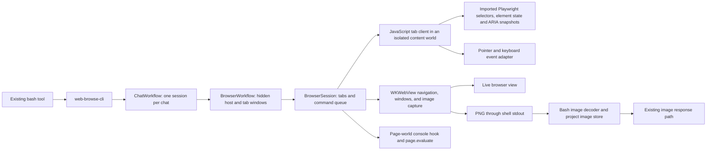

# Browser API exploration

This is a runnable first slice for inspecting how browser APIs fit together in Local Code.
The entry point is **`web-browse-cli` in the app's existing shell**. It has subcommands and a
JavaScript client, with no additional model-facing tool registrations. The implementation
uses the app's WKWebView; it does not require a separate desktop browser or Node daemon.

## Try the pieces

Run these through a Local Code app chat's bash tool. `web-browse-cli --help` lists the commands.
The standalone macOS `local-code` executable does not currently host browser sessions.

```sh
web-browse-cli open https://example.com
web-browse-cli snapshot --boxes --image
web-browse-cli dom
web-browse-cli inspect 'h1'
web-browse-cli run --code 'async (tab) => ({title: await tab.title(), heading: await tab.playwright.getByRole("heading").innerText()})'
web-browse-cli console
web-browse-cli screenshot
web-browse-cli show
```

`show` presents the same live web view that the commands drive: in a window of its own on
Mac, or a sheet on iPhone and iPad. A person can inspect it or interact manually, then close
it and continue issuing commands against that tab. While the window or sheet is open, the tab's
output from `open`, `goto`, `reload`, `show`, and `tabs` carries `shown: true`.
`open` creates and selects a tab; `tabs` lists IDs and marks the selected one. `--tab <id>`
addresses a tab on any other command and selects it for later commands; on `tabs` it only
switches. `goto
<url-or-html-file>` navigates the selected tab, `reload` loads it again (`--from-origin` bypasses
the cache for the page and its resources), and `close` removes it. A bare host such as
`localhost:5173` (http) or `example.com` (https) is a web address unless a file by that name
exists. Tabs belong to the owning chat's browser session and last while the app runs.
Cookies and other website data belong to the project: its chats share one WebKit data store,
kept across launches from iOS 17 under a UUID derived from the project's path, and in memory
on earlier systems. `clear-cache` removes that store's disk, memory, and fetch caches and keeps
cookies and site storage; open tabs keep the pages they loaded until they reload. Closing the
presentation retains the session.

For a repeatable local task, open `Tests/BrowserAPITests/fixture.html` relative to this app
directory, or its path relative to your project. Save this function expression as
`browser-task.js` in the project:

```js
async (tab) => {
  await tab.playwright.getByLabel('Full name').fill('Liu Liu');
  await tab.playwright.getByRole('checkbox', { name: 'Enabled' }).check();
  await tab.playwright.getByLabel('Country', { exact: true }).selectOption('ca');
  await tab.playwright.getByRole('button', { name: 'Save profile', exact: true }).click();
  return {
    saved: JSON.parse(await tab.playwright.getByRole('status', { name: 'Result' }).innerText()),
    snapshot: await tab.playwright.domSnapshot(),
  };
}
```

```sh
web-browse-cli run --file browser-task.js
web-browse-cli screenshot --file $TMPDIR/profile.png --inline --full-page
```

The fixture tracks application state separately from the input's DOM value, the way
controlled inputs do. The result should contain `name: "Liu Liu"`, `enabled: true`,
`country: "ca"`, and `inputEvents: 1`. File arguments use the app's existing project,
`~`, `$TMPDIR`, `/app_bundle`, and permitted-directory path resolver.

## Observations and their size

`snapshot` returns ARIA text; `snapshot --json` returns structured nodes. `--boxes` includes
bounds, and `--depth <n>` limits depth. `dom` returns the ARIA-referenced elements whose bounds
intersect the viewport, leaving out unnamed generic containers unless they look clickable.
Each entry carries a role, name, short text, value, a few identifying attributes, bounds, and a
node ID. This is not a complete HTML dump or an operating-system accessibility tree.

Snapshots and `dom` go into a model's context, so they stop at 20000 characters unless
`--max-chars` (or `maxChars` in the JavaScript API) says otherwise. Text snapshots end at a line
boundary, structured snapshots drop nodes past the budget, and `dom` drops entries; each says
so under `notes` in the result. On the English Wikipedia article for WebKit, the unbounded
text snapshot was 216000 characters and the old `dom` output 227000, mostly from container
elements repeating their descendants' text.

`console` returns what the page's own world logged: console calls, uncaught errors, unhandled
rejections, failed resource loads, and JavaScript dialogs. The last 200 entries are kept per
tab across navigations, each with the page URL; `--clear` empties the buffer after reading.

Tabs identify as Safari. WebKit's user agent in an app stops before Safari's `Version/…
Safari/…` tokens, so `SafariUserAgent` appends them, desktop on iPad and Mac and mobile on
iPhone, and pins the content mode to match. The page's world has no message handler, since one
would add `window.webkit`, which Safari pages never see. The console hook posts document events
under a per-launch name to a relay in the client's world, and its wrappers report the native
source, name, and length. Service workers stay unavailable: WebKit enables them in apps only
for app-bound domains.

## Images through bash

`screenshot` emits a viewport PNG using the same OSC 1337 inline image protocol that bash
now decodes. `--full-page` captures the full document. Without `--file`, image output is the
default; `--inline` makes image output explicit and can be combined with `--file`. Images have
one pixel per CSS pixel, so snapshot boxes are image coordinates. iOS lays out a page without
a viewport tag at 980 CSS pixels and scales it into the view, so such a page's viewport image
is 980 pixels wide.

`snapshot --image` returns the usual ARIA or structured JSON snapshot followed by a viewport
PNG. This lets the model inspect element references and pixels in one bash response.
`snapshot` without `--image` remains text only. The accessibility query runs before capture;
page scripts and animations can still change the document between those observations.

The shell writes JSON text and the image escape sequence. Bash extracts the PNG into the
project image store and returns an `imageDigest` alongside the text, including output
consumed through `bash_wait` or `bash_status`. Existing model and chat media handling consume
that image without a separate `view` call. Models without image support receive text only;
the terminal payload is stripped. Use `--file` when a saved artifact is useful independently
of model image input.

## What is imported and what is implemented here



**Imported:** the unmodified browser-side injected runtime from `playwright-core 1.64.0`.
Its selector engines, role and accessible-name calculations, shadow-root traversal,
element-state checks, fill/select primitives, hit-target checks, and ARIA snapshot/ref
generation are used directly. The archive integrity and extracted source hash are recorded
in [the vendor metadata](../../../Vendors/Playwright/SOURCE.json); the Apache license ships
with the runtime. [The importer](../../../Vendors/Playwright/import.mjs) reproduces the exact
source extraction without installing npm dependencies or browser binaries.

**Implemented here:** retained WebKit tabs, command parsing and dispatch, cancellation, a
Codex-style `tab.playwright` / `tab.dom_cua` client, pointer and keyboard input, PNG capture,
windows opened by pages, console capture, and presentation of the live tab. This imports
Playwright's browser-side implementation rather than wrapping the complete upstream `Page`
driver. The method names and option names (`timeout`, `position`, `modifiers`, `force`,
`state`) follow Playwright so familiar query and interaction code works.

| Surface | Available in this slice |
| --- | --- |
| Locator construction | `locator`, `getByRole`, `getByLabel`, `getByText`, `getByPlaceholder`, `getByTestId`, `getByAltText`, `getByTitle`; chaining, `filter`, `first`, `last`, `nth`, `and`, `or` |
| Locator reads | `count`, `all`, `allTextContents`, `innerText`, `textContent`, `getAttribute`, `inputValue`, `isVisible`, `isEnabled`, `boundingBox`, `elementInfo`, `ariaSnapshot` |
| Locator interaction | `click`, `hover`, `focus`, `blur`, `fill`, `press`, `pressSequentially`, `setChecked`, `check`, `uncheck`, `selectOption`, `scrollIntoViewIfNeeded`, `waitFor` |
| Page input | `tab.playwright.keyboard.press`, `type`, `insertText` |
| Inspection | `tab.playwright.domSnapshot`, `snapshotJSON`, `elementInfo`, `evaluate` (isolated world); `tab.page.evaluate` (page world); locator `evaluate` / `evaluateAll` |
| DOM node view | `tab.dom_cua.get_visible_dom({maxChars?})`, `click({node_id})`, `scroll({node_id?,x?,y?})` |
| Native tab operations | CLI `open`, `goto`, `reload`, `tabs`, `close`, `show`, `screenshot`, `console`, `clear-cache`; JS `tab.id`, `tab.url()`, `tab.title()` |

Reads/actions that require one element reject ambiguous locators. Attached/visible/enabled/
editable checks wait up to five seconds by default, or `{timeout: ...}`; a command has a
30-second host limit. Queries are re-resolved at use time. Commands within a session
serialize, and cancellation or a timeout settles the running script at once and fences its
later actions, including a script whose client is still being installed and a screenshot that
has not been saved yet. Dispatched events and arbitrary JavaScript effects cannot be undone. Script
output is JSON: `{result, tab, documentId, url, title}`, plus `notes` and `openedTabs` when
they apply; command errors go to stderr with a nonzero exit status.

## Input

WebKit offers no trusted input injection for an app's web view, so input is synthetic. A click
scrolls the element into view, checks that it receives the pointer at its center, and then
sends `pointerover`/`mouseover`, enter events to each newly entered ancestor, `pointermove`,
`pointerdown`, `mousedown`, focus (the nearest focusable ancestor, or a blur), `pointerup`,
`mouseup`, and `click`. Components that open on `pointerdown` or `mousedown` therefore respond,
and the dispatched `click` still runs activation: links navigate, labels and checkboxes toggle,
and buttons submit. Hover sends the same move and enter/leave sequence.

Keys send `keydown`, `keypress`, and `keyup` with Playwright's key names, then perform the
default the page did not prevent, since untrusted events have none: text insertion through
the editor, Enter as implicit form submission or activation, Tab focus movement, and Space
activation. In fields, arrows, Home, and End move the caret through the selection's `modify`
(Shift extends, Alt or Control moves by word, Meta to the line or document edge), Backspace
and Delete remove a character, word, or line the same way, and arrows step number and range
inputs. Control or Meta with A selects all, and with Z, Shift+Z, or Y asks WebKit's undo
manager, which a web view outside a window lacks. Elsewhere, navigation keys and Space scroll
the nearest scrollable ancestor or the page. A default the client cannot perform (the
clipboard, `<select>` and radio keys, Alt character composition) is an error after the page
receives the events, so a successful press means the edit happened. `fill` selects the current text through Playwright and replaces it through the
editor, so frameworks receive `beforeinput` and `input` the way typing produces them. Key
events carry `keyCode` and `which` for a US layout, for listeners written before `key` and
`code`. CSS `:hover` does not apply to synthetic events.

## Windows, dialogs, and crashes

A page may open a window within about a second of a command's click, which WebKit counts as a
user gesture. The window becomes a selected tab in the same session, using the configuration
WebKit supplies so the opener relationship survives (sign-in windows post back to it). The
command that clicked waits for the window and lists it under `openedTabs`. `window.close()`
removes the tab and selects its opener. Dialogs are dismissed (`confirm` answers false) and
recorded for `console`.

A main-frame navigation the page starts, from a click or its own script, holds the command
from WebKit's policy check until the page loads or fails, so the next command sees the new
page. The output then carries the new `url` and `title` (read from the document, since
`WKWebView.title` can lag the load) and a note; a failed load is a note instead. A response
WebKit cannot show is declined and reported as a download that names its URL, as a note after
a click and as the error from `goto`. A navigation that commits while a script is still running
ends that script, since WebKit never answers it.

If WebKit's web content process ends, usually under memory pressure while a local model is
loaded, the running command fails immediately with an error that names the `goto` command to
reload the tab; `tabs` marks the tab `crashed`. A script whose document is replaced by a
navigation ends with an error instead of waiting for the command limit.

## Hosting and lifecycle

On iOS, a WKWebView outside a window reports the page as hidden, runs no animation frames,
and cannot produce a full-page PDF capture. Hidden tabs therefore sit in a clipped one-point
view at the back of the chat's window. A scripted `focus()` there would take the keyboard from
the chat input, so the tab's web view refuses first responder until `show` presents it; pages
still receive focus events and editor input. These behaviors were measured in the iOS
simulator. `show` moves the tab's web view into a `UnifiedBrowserWindowWorkflow` and lays the page out
at its size; closing it returns the web view to the hidden 1100 by 850 viewport.

On Mac, measured on macOS 27 with a Catalyst app that hosts web views the same way, hidden tabs
paint and run animation frames at full rate while the chat window is visible, inactive, or
covered by other windows. When the window is minimized or the app hidden, its scene goes to the
background, and when the displays sleep, Catalyst moves every scene of the app there. WebKit
then pauses the page: it reports itself hidden, animation frames stop, timers
run about once a second, and `takeSnapshot` waits until the window returns. Setting
`inactiveSchedulingPolicy` to `.none` does not change this. PDF capture still works, so while a
tab's window is in the background, `screenshot` and `snapshot --image` draw the viewport through
it, showing the page as last drawn, and say so under `notes`. A canvas the page draws from
animation frames stays as it was, or blank if the page loaded while paused.

On Mac the window is a scene of its own, one per tab, with back, forward, and an address field
beside the traffic lights, which are moved to the middle of that row. The rim glow stands in
for its shadow: a borderless, click-through AppKit window ordered just below it as a child,
which AppKit moves and reorders with it. A `show` for a tab whose window is open brings that
window to the front. macOS restores scene sessions on launch; browser sessions are discarded,
since tabs do not outlive the app. On iPhone and iPad the window is a sheet from the chat, one
tab at a time.

`ChatWorkflow` keeps one browser per chat, identified by project and thread, until its window
closes. The thread menu in Recents and All Projects offers to close a chat's browser tabs while it
has a browser, after a confirmation; deleting the chat or its project closes them too, ending their
web processes. None of these clear the project's website data, so sign-ins and bot checks a site
passed carry over to the next tab and launch. Deleting the project deletes its data store, and
Clear browser data in the project's menu, shown once the project has one, removes its data after
a confirmation while open tabs stay open. A renamed or moved project folder starts a new store. The Activities rail lists every open tab, the open chat's first: a row opens the
tab's window, or brings it to the front, and its minus button closes the tab, failing a command
that is running against it.

## Boundaries to examine through usage

The client currently targets the main document, including open shadow roots. It runs in a
WebKit isolated content world: it sees and can mutate the shared DOM, while page-script
globals are in a different world. `tab.playwright.evaluate` is arbitrary JavaScript within
this world; `tab.page.evaluate` reaches the page's globals with JSON-like values only.

Synthetic input works on the fixture's controlled input, pointer-down menu, hover card, and
keyboard form, but it is not Playwright's trusted mouse/keyboard pipeline and does not
guarantee compatibility with every web application. Drag and drop, iframe locators, file
upload, saving downloads, network interception, and saved login profiles are not implemented
in this slice.

These are implementation boundaries for the experiment, not conclusions about the final
browser tool surface or backend choice. The earlier [BrowserUseHandoff](BrowserUseHandoff.md)
remains a disputed proposal; this slice provides concrete behavior to evaluate first.

## Validate

On a macOS host with WebKit/LaunchServices available:

```sh
bazel test //Apps/LocalCode:BrowserAPITests --test_output=errors
bazel build //Apps/LocalCode:LocalCode --ios_multi_cpus=arm64
```

The native fixture harness exercises request parsing, destination resolution, and the session
and browser client on a real WKWebView: accessible-name queries, hidden and duplicate elements,
controlled form state, the `timeout` option, shadow DOM, snapshots and refs, output budgets,
pointer-down menus, hover, keyboard input and implicit submission, caret and selection keys,
scrolling keys, rejected key defaults, legacy key codes, focus, page-world
evaluation, console and dialogs, windows opened and closed by pages, tab selection, a click that
loads a page, download links and `goto` to a download, navigation during a script, a killed web content process, document replacement, `reload`, a
cacheable script that a later page takes from the cache and that `reload --from-origin` and
`clear-cache` make WebKit fetch again from a local server, cancellation during
client installation, a cancelled screenshot, a cancelled navigation with a command queued
behind it, inspection, and PNG output. It also invokes the actual `web-browse-cli` shell entry through `BashTool`, consumes
output through waits, and checks stored image digests, combined snapshot/image responses,
file-plus-inline byte equality, repeated polls, and text-only model behavior. Full-page
verification checks a colored marker below the initial viewport.

The app build validates the shell callback and UIKit integration separately. The iOS hosting
behavior (visibility, animation frames, keyboard focus, both capture paths, windows, and the
sheet round trip) was checked with the same sources in the iOS simulator; physical iPhone/iPad
behavior under memory pressure still needs device testing.
