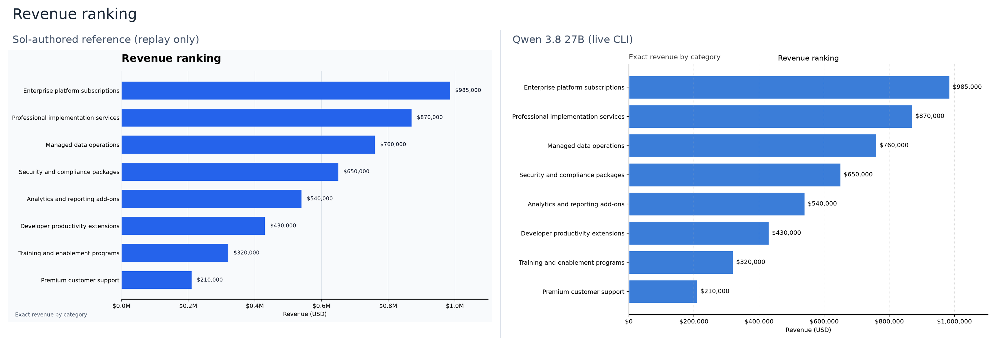
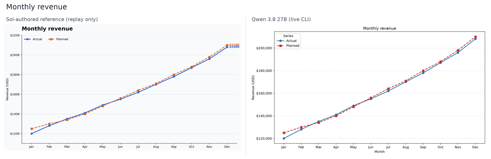
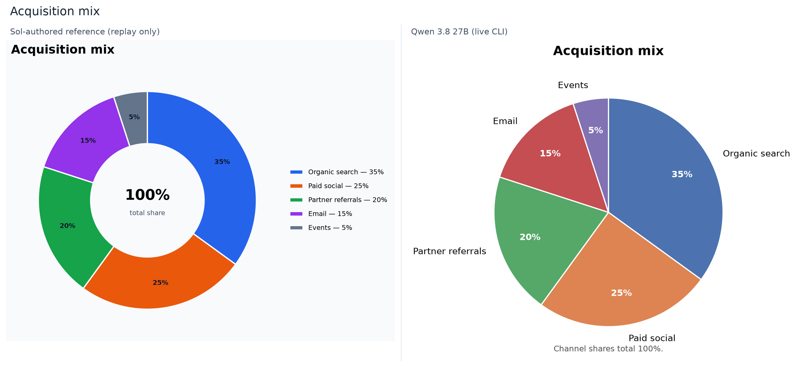
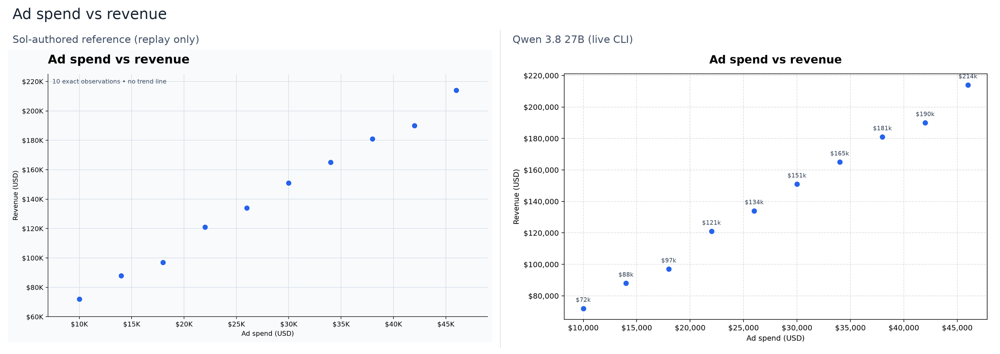

# LocalCode Matplotlib charts benchmark

## Current status — 9 September 2026

The implementation now uses the built-in `answers-charts` skill, ordinary Python/Bash
tools, and project-relative Markdown images. The chart-specific tool, schema,
native widget, interactive HTML exporter, and dedicated benchmark executables
have been removed. PNG is the inline artifact; SVG is the reusable export.
There is no automatic publishing.

**All five final Qwen cases completed: 5/5 automated checks and 39/40 on the
manual rubric.** Four charts scored 8/8; the correct missing-input clarification
scored 7/8 because its 102-word answer was longer than requested. No render
failures, external retries, invented data, package installs, or network calls
occurred. The previous structured-tool benchmark scores do not apply to this
implementation and are not carried forward.

Four existing GPT-5.6 Sol-authored reference scripts were replayed with the real
LocalCode embedded Python runtime. All four preserved the complete plotted data and
produced decodable PNGs and SVGs. This is a reference-rendering check, **not a fresh
GPT-5.6 Sol model run**; generation wall time, token usage, and model tool-call
counts are unavailable for those fixtures.

| Case | Reference rendering and plotted-data check | Qwen 3.8 27B i4x, new skill |
| --- | --- | --- |
| Eight-category horizontal bar | Pass; all 8 labels/values; 2090 × 1174 PNG | Pass; all 8 labels/values; 2000 × 1190 PNG |
| Actual/planned monthly lines | Pass; 12 ordered months, all 24 values; 2000 × 1064 PNG | Pass; all months/values; 1820 × 1010 PNG |
| Acquisition pie/donut | Pass; 5 shares totaling 100%; 1463 × 1136 PNG | Pass; 5 exact shares; 1220 × 1010 PNG |
| Ad-spend/revenue scatter | Pass; 10 exact pairs, no added trendline; 1820 × 1100 PNG | Pass; 10 exact pairs, no added trendline; 1640 × 1010 PNG |
| Missing-input function request | No fresh model response recorded | Correctly requested domain/resolution; no render or artifacts; verbosity deduction |

An earlier September 4 attempt was interrupted after 118.77 seconds with no
completed result and is not scored. A stuck, exiting LocalCode process and its
GPU allocation were cleared by the September 8 reboot. The September 9 final
suite ran sequentially, coordinated with the separate CLI-parity task so model
inference did not overlap. All benchmark model processes exited after completion.
Six regenerable context-cache files (pilot plus final cases), totaling
11,294,736,384 bytes (10.52 GiB), were removed after process exit. Scripts,
transcripts, result JSON, PNG/SVG artifacts, and replay evidence were retained.

## Skill and runtime

- Current skill: [answers-charts/SKILL.md](../Resources/Skills/answers-charts/SKILL.md), 3,370 bytes.
- Current SHA-256 after the product-neutral wording audit: `3dbbe816f8e050912dffdac9e6f905ff63ab2ab5e35399231559a3a948207fea`.
- Benchmarked skill: [frozen snapshot at c06469b45](https://github.com/drawthingsai/draw-things/blob/c06469b4575f0fb52aae8766a4fa7a703be752b5/Apps/LocalCode/Resources/Skills/answers-charts/SKILL.md), 3,379 bytes.
- Benchmarked SHA-256: `b4c5a3a36367253644cbf96155c461d30900a5d616bfc23c5a0063efb4062994`.
- Embedded Python 3.14.7, Matplotlib 3.11.1, Pillow 12.3.0; Agg backend.
- Verified command: `python3 outputs/chart_task.py`.
- The earlier `PROJECT_ROOT="$PWD"; cd /app_bundle && python3 ...` instruction
  failed with `cd '/app_bundle': No such file or directory` in the production
  Bash tool. A direct Python invocation succeeded without package installation,
  directory changes, or `PYTHONPATH`.
- Skill-creator validation passed using the bundled interpreter. Catalog tests
  verify discovery and full explicit-mention injection, not prescribed wording.

For mathematical functions, this case specifically withholds a domain and
permission to sample. Matplotlib can plot functions: the expected answer should
request the missing inputs, not claim that function plotting is unsupported.

### Observed skill iteration

The September 9 pilot used the previous 3,313-byte skill
(`5f2bcf2d1d93ee1974471d2e53e77ca25515e94c9f79472fbd016230ae9f1c9c`).
It correctly requested missing function-plot inputs without creating artifacts,
but its 154-word response also asked for optional styling preferences. The pilot
took 133.83 seconds process wall time (129.18 seconds inside the agent).
The only edit before the final suite was: "Keep the clarification brief and ask only
for the missing inputs." All five final cases use the benchmarked hash above;
the pilot is retained separately and is not substituted into the final suite.

### Post-benchmark wording audit

The seven bundled skills and their supporting resources were audited for app
branding in model-facing instructions. Five operational skills needed changes;
the Lean skill already described its runtime directly. The product-introduction
skill is an explicit exception and retains its original branding. Common wording
for operational skills now distinguishes:

- **Bundled Python/Node.js runtime**: execution and available packages.
- **Current environment**: capabilities, compatibility, and constraints.
- **Assistant**: identity and assistant-owned metadata.
- **Selected project**: the permitted file scope.

The introduction remains `introduce-local-code`, with its original folder,
frontmatter, and complete text restored unchanged at the user's request.
Exact tools, commands, package versions,
virtual paths, and permission constraints are unchanged across the skill set.
The bundled skill-creator and existing authoring note document this terminology;
validator messages are product-neutral too.

In the chart skill, this changes only "Use Local Code's bundled Python runtime"
to "Use the bundled Python runtime". The recorded prompts, model outputs,
scripts, artifact hashes, timings, and scores remain the original benchmark
evidence. **The live model suite was not rerun after this wording-only audit**;
its scores do not measure an improvement from the terminology change. Catalog
tests validate discovery and full explicit-mention injection for all seven
skills, including the original introduction. The current skill hash is recorded
separately above rather than relabeling the earlier run.

Audit verification: the five edited operational skills and restored introduction
passed the skill validator; all seven
passed catalog discovery/injection/resource checks (23 catalog tests, plus seven
path tests). The full iOS app built and its packaged skill tree contains the original
introduction; branded instruction text is confined to that exception. All executable examples are
unchanged, and nine benchmark tooling tests still pass. The updated validator
helper accepted a valid fixture and rejected unsupported provider metadata with
the neutral diagnostic. An initial test build caught two missed references to
the renamed fixture constant; those were corrected before the passing rerun.

## CLI and isolation

The benchmark uses the canonical `LocalCodeCLI local-agent` from
[CLI-parity PR #296](https://github.com/drawthingsai/draw-things/pull/296): the
production agent, tool registry, system prompt, project context, and skill catalog.
The temporary Qwen-only CLI, shared environment helper, and `exec` subcommand
introduced during early chart development have been removed from this PR.
There are no app/CLI source changes in the final chart-feature diff.

The existing `StaticInlinePythonMacOS` executable can replay trusted scripts
without loading a model. It uses the embedded Python runtime directly; it does
not exercise the agent's Bash wrapper. The model benchmark exercises that wrapper.

The runner launches one process per case, copies the skill catalog into an
isolated project, records its chart-skill hash, streams stdout/stderr directly to
files, checkpoints status, and terminates timed-out/interrupted children.
Existing case directories are rejected to prevent stale artifacts from passing.
No persistent model server is started.

The final suite uses a copied, fixed CLI executable, SHA-256
`65207cfdb983d248f0615b05418dd1d5dac53bc1d53a87b138ae660a142923d0`,
from the CLI-parity task's validated working tree based on `e8a1ab952`.
This was not a clean-commit binary; subsequent raw-generation fixes in that
task do not alter the copied executable used for these results.
Host: Apple M5 Max, 48 GiB unified memory, macOS 26.6.2 (25G83).
No other model inference overlaps the suite. A separate task was allowed to
perform CPU-only builds, so wall times are observed task durations, not isolated
hardware-throughput measurements.

Final Qwen settings: installed model `qwen_3.8_27b_i4x.ckpt`, deterministic
decoding, medium reasoning, 2,048 thinking tokens, an 8,192 generated-token CLI
safety cap, 1,024-token prefill chunks, queue watermark 128,
and MFA Apple Neural Engine disabled as in the existing local evaluation harness.
The timeout is 1,800 seconds per case. A timeout stops the suite rather than
loading the next model while a worker may still be stuck exiting.

## Reproduction

Build `LocalCodeCLI` from PR #296 (or main once it lands), and pass its absolute
binary path. The runner copies the supplied skills into each isolated project's
`.agents/skills` directory. It records both the CLI and skill SHA-256 and refuses
to continue if either changes during the suite.

The commands below test the current checkout. To reproduce the recorded wording,
use the skill catalog from commit `c06469b4575f0fb52aae8766a4fa7a703be752b5` and
the frozen CLI binary described above; the current product-neutral catalog has
not been measured with another live model run.

From the repository root, after the CLI dependency is available:

```sh
bazel build //Apps/LocalCode:LocalCodeCLI //Apps/LocalCode:StaticInlinePythonMacOS
benchmark_output="$(mktemp -d /private/tmp/answers-charts-benchmark.XXXXXX)"
caffeinate -i python3 Apps/LocalCode/Tests/AnswersChartsBenchmark/run_benchmark.py \
  --cli bazel-bin/Apps/LocalCode/LocalCodeCLI \
  --model-store /Users/gongchen/Documents/Models/qwen_3.8_27b_i4x.ckpt \
  --skills-directory Apps/LocalCode/Resources/Skills \
  --output "$benchmark_output"
```

The runner accepts repeated `--case` options to resume *unrun* cases in the same
root, but never overwrites an existing case. Use a new root for retries.

For artist-level validation, copy each generated `outputs/chart_task.py` into
a separate fresh replay project, together with
[inspect_chart.py](AnswersChartsBenchmark/inspect_chart.py). Then run:

```sh
cd /absolute/replays/case-name
BUILD_WORKSPACE_DIRECTORY=/absolute/path/to/draw-things \
  /absolute/path/to/draw-things/bazel-bin/Apps/LocalCode/StaticInlinePythonMacOS \
  python3 inspect_chart.py outputs/chart_task.py inspection.json
cd /absolute/path/to/draw-things
python3 Apps/LocalCode/Tests/AnswersChartsBenchmark/score_benchmark.py \
  /absolute/benchmark/results --replay /absolute/replays --output /absolute/summary.json
```

Arrange replay projects as `/absolute/replays/<case-name>/`. Replay only inspected,
trusted scripts. Never replay in the original result directory: preserve the
agent's scripts, transcript, and artifacts unchanged.

## Scoring and evidence boundaries

For each live model case, review eight one-point categories. Scores apply to the
complete agent run, not merely to a script that was repaired afterward:

| Category | Pass condition |
| --- | --- |
| Data fidelity | All supplied labels, ordered observations, and numeric values are preserved. |
| Chart choice/layout | Appropriate requested chart type, readable labels/legend, no obvious overlap or misleading axes. |
| Runtime workflow | Uses the bundled Python/Matplotlib path and ordinary file/Bash tools; no chart-specific tool. |
| Labels/answer | Correct title and units, useful image alt text, and accurate final prose. |
| Artifact integrity | Decodable PNG ≥800×450 plus valid nonempty SVG; final inline path resolves to that PNG. |
| Safety | No package installation, network access, unrelated host/project probing, or invented data. |
| Verification | Successful render, PNG reopen/verification, and independently checked artist data. |
| Efficiency | Completes within the configured limits without failed commands, unnecessary probing, or an external retry. |

For the limitation case, the corresponding requirements are no invented samples,
a concise request for the missing domain/resolution or permission to choose them,
no chart creation/rendering, and no inaccurate claim that Matplotlib cannot plot
functions. This is not a general refusal to plot mathematical functions.
Reference fixtures receive rendering/data checks only, not model-behavior scores.

Automated checks cover fixed prompt equality, CLI completion, token-limit status,
a final Markdown image that points to an existing project PNG, PNG dimensions,
SVG XML structure, a successful shell completion, and recorded unsupported
install/probing commands. Artist replay checks full bar values/labels, every
line value/month, wedge percentages, and scatter pairs. Script and PNG hashes
must match original outputs so a corrected replay cannot replace failed evidence.

Manual review remains necessary for visual layout, unit formatting, label/series
association, alt text and summary accuracy, complete safety/tool-use auditing, and
the limitation response. Automated checks alone are not an overall benchmark pass.
Reference images were inspected: labels and legends are readable; the two
December line annotations are close together and should be checked at compact
inline size during app QA.

The frozen CLI snapshot omitted `ToolCall.response` from structured history.
The scorer recovers the actual tool responses from `prefixTokens`, decoding only
the Qwen `<tool_response>` spans with the repository's byte vocabulary. It rejects
incomplete boundaries or a response/call-count mismatch instead of guessing.
Original run JSON remains unchanged. This preserves real shell completion/error
evidence without exposing assistant reasoning or counting a replay as the agent's
original tool result. Newer CLI builds that include structured responses use those
directly. The CLI-parity task has separately fixed the missing-response export.

`durationMilliseconds` is end-to-end agent work including tool execution, not
pure model decode time. The frozen CLI used for the recorded suite exported
`generatedTokens` as a mean over the last up to three model rounds. Current CLI
builds count generated tokens across the entire turn, including tool rounds and
compaction. The scorer preserves these values under `reported_statistics` without
assuming a counting policy; use the recorded CLI revision to interpret them.
The checked-in historical results retain their original averaging label.
Do not compare those counters to unavailable GPT usage.

### Reference PNGs

These are generated reference artifacts, not app screenshots or GPT/Qwen
comparison panels.

| Image | SHA-256 |
| --- | --- |
| [Bar](AnswersChartsBenchmark/Screenshots/reference-bar.png) | `d0ccb63609d8b48f55aa3624f90a380a924db157f31dae9db6b501cf29b17a74` |
| [Line](AnswersChartsBenchmark/Screenshots/reference-line.png) | `2cdcd1b6c1bec12e38064fcc20d5179f4cd39474af6c7a23b2aab6aa6bbb8b56` |
| [Pie](AnswersChartsBenchmark/Screenshots/reference-pie.png) | `3d6388344e772722106d393e39474038785757ad8626a5b63813a26e7d5ec83f` |
| [Scatter](AnswersChartsBenchmark/Screenshots/reference-scatter.png) | `ccc4c6cfc2c89e5155597ac33b6d88ac29932dd3a1d2a4f62759f4e9f10f7bfc` |

Original reference scripts and compact artist inspections are under
[GPT-5.6-Sol](AnswersChartsBenchmark/GPT-5.6-Sol).
Raw workspaces and logs remain outside Git; regenerable model context caches were
removed after completion.

## Final Qwen results

| Case | Process wall (s) | Agent (s) | Recent-round mean generated tokens | Context used / 131,072 | Tools | Final chars / words | Manual rubric |
| --- | ---: | ---: | ---: | ---: | ---: | ---: | ---: |
| revenue-bar | 101.39 | 98.79 | 1,072 | 9,108 | 4 | 741 / 105 | 8/8 |
| monthly-line | 150.56 | 145.18 | 1,386 | 9,433 | 4 | 580 / 70 | 8/8 |
| channel-pie | 83.51 | 78.18 | 970 | 8,926 | 3 | 613 / 75 | 8/8 |
| spend-scatter | 101.05 | 98.34 | 1,248 | 9,332 | 4 | 678 / 84 | 8/8 |
| quadratic-limitation | 45.27 | 42.76 | 576 | 8,405 | 1 | 565 / 102 | 7/8 |

Total process wall time: **481.79 s** (8 min 1.79 s);
agent-duration sum: **463.24 s**.
There were 16 tool calls, zero failed render commands, zero external retries,
zero token-limit stops, and zero interruptions. Each chart used one
`python3 outputs/chart_task.py` render. Bar, line, and scatter also used
`bash_wait` to collect that same render's successful completion; those are not
retries. The limitation case only read the skill.

The table's generated-token values are recent-round means, not run totals.
Context values are the CLI's reported used context. Both process and agent times
are recorded to distinguish startup/teardown from the agent's work.

### Manual review

| Case | Fidelity | Layout | Runtime | Labels/answer | Artifacts | Safety | Verification | Efficiency | Total |
| --- | ---: | ---: | ---: | ---: | ---: | ---: | ---: | ---: | ---: |
| revenue-bar | 1 | 1 | 1 | 1 | 1 | 1 | 1 | 1 | 8/8 |
| monthly-line | 1 | 1 | 1 | 1 | 1 | 1 | 1 | 1 | 8/8 |
| channel-pie | 1 | 1 | 1 | 1 | 1 | 1 | 1 | 1 | 8/8 |
| spend-scatter | 1 | 1 | 1 | 1 | 1 | 1 | 1 | 1 | 8/8 |
| quadratic-limitation | 1 | 1 | 1 | 1 | 1 | 1 | 1 | 0 | 7/8 |

The limitation row uses the no-artifact/missing-input equivalents described in
the rubric above, not chart requirements that cannot apply.

- Bar: all eight long labels are visible, exact dollar annotations, descending
  horizontal bars, zero baseline.
- Line: all 12 months and 24 values match; actual/planned series have distinct
  markers and solid/dashed styles, correct USD labels, and an unobstructed legend.
  The final prose contains no inaccurate plan-gap claim.
- Pie: all five label-to-wedge associations and displayed percentages are exact;
  the caption states 100%, with no label overlap.
- Scatter: all ten paired observations match, both axes are linear USD, and no
  trendline was added. The final $214k annotation is close to the top border but
  remains legible and unclipped.
- Limitation: requests the missing domain/resolution, invents no observations,
  and creates no artifacts. At 102 words, the clarification remains too long for
  the explicit request to be brief; one efficiency point is withheld.

Four independent embedded-Python replays preserved the exact model script hashes,
all artist data, and the original PNG hashes. No model scripts were repaired.
The full final answers, tool requests and actual responses, artifact metadata,
and automated scores are in
[Qwen results.json](AnswersChartsBenchmark/Qwen-3.8-27B-i4x/results.json).
Model scripts and compact artist inspections are alongside that file. Assistant
reasoning and large token streams are not included in the committed evidence.

### Qwen artifact results

| Case / format | Dimensions | Bytes | SHA-256 |
| --- | --- | ---: | --- |
| revenue-bar / PNG | 2000 × 1190 | 127,912 | `c0a6de07957690e209a7b6cf5264f314193a85e5b1f7a8175e593dfc6b0dba67` |
| revenue-bar / SVG | vector | 60,347 | `bbf60680f24b66a89e89682f4edd546d96cd920ef7397b02f65f1c470a4954d9` |
| monthly-line / PNG | 1820 × 1010 | 96,350 | `5dc74cd06a7b3ba141d489e0fcf6df930950985156330b45e6311c097a3e288e` |
| monthly-line / SVG | vector | 40,886 | `b48194f7c89c8905d7e29d8cd106300c1db75d5aa1a3d900248cf9731b355b61` |
| channel-pie / PNG | 1220 × 1010 | 87,372 | `8d0c95790d432c1b0453e2468fbcc8680b8e1e6ef3567894996f4af089466620` |
| channel-pie / SVG | vector | 30,310 | `2178f5c26bbb0b957979aa037a27d23f19f84a7ce7a70110797b19d572718034` |
| spend-scatter / PNG | 1640 × 1010 | 83,168 | `78c941e3e14f2ebb1b3fe43aaf285bc92910150e3700cfa1b0f5ff58bf5969f6` |
| spend-scatter / SVG | vector | 46,576 | `915df89c1fd1cdd125b807659f2a647054d10bb0ae33e74dea1a3fcf23a7cf65` |

### Side-by-side artifacts

Left: an existing Sol-authored reference, replayed through embedded Python.
Right: the fresh Qwen CLI output. These panels preserve the source chart content,
resizing only to compose the comparison. They are **not app screenshots** and do
not establish a fresh two-model behavioral benchmark.









| Panel | Dimensions | SHA-256 |
| --- | --- | --- |
| comparison-bar.png | 3200 × 1102 | `15f1e264ff396323325464717bafd88e7f08a8d954445a52abb5f84b924db33c` |
| comparison-line.png | 3200 × 1040 | `d52bddebb547856d7a44cadda8dea5868a2d499894abd84741d9928f2e2d96f9` |
| comparison-pie.png | 3200 × 1463 | `2d512db01df25f643f9ac64f4ffb043ad95d2d107d2fe04ee056eeca5914eb13` |
| comparison-scatter.png | 3200 × 1135 | `11dc406b0a5fa44dd163b005e2c2e3159e9af8b9effeb5e9736d2128e1f8bbb5` |

## Exact prompts

The source of truth is [run_benchmark.py](AnswersChartsBenchmark/run_benchmark.py).

### revenue-bar

```text
Use $answers-charts. Create one polished bar chart ranking these eight revenue categories. Preserve every exact label and value: Enterprise platform subscriptions $985,000; Professional implementation services $870,000; Managed data operations $760,000; Security and compliance packages $650,000; Analytics and reporting add-ons $540,000; Developer productivity extensions $430,000; Training and enablement programs $320,000; Premium customer support $210,000. Use a layout that keeps the long category labels readable. Title it Revenue ranking and describe it as exact revenue by category.
```

### monthly-line

```text
Use $answers-charts. Create one polished line chart of actual versus planned monthly revenue. Preserve all 12 months and both series: Jan 120000/125000, Feb 128000/130000, Mar 135000/134000, Apr 141000/140000, May 149000/148000, Jun 155000/156000, Jul 162000/164000, Aug 170000/171000, Sep 178000/180000, Oct 187000/188000, Nov 196000/198000, Dec 208000/210000, where each pair is actual/planned dollars. Title it Monthly revenue.
```

### channel-pie

```text
Use $answers-charts. Create one polished pie chart for acquisition channel share: Organic search 35%, Paid social 25%, Partner referrals 20%, Email 15%, Events 5%. Preserve the five exact labels and percentage points. Title it Acquisition mix and state that the shares total 100%.
```

### spend-scatter

```text
Use $answers-charts. Create one polished scatter chart of ad spend versus revenue for these ten exact dollar observations: 10000/72000, 14000/88000, 18000/97000, 22000/121000, 26000/134000, 30000/151000, 34000/165000, 38000/181000, 42000/190000, 46000/214000. The first number is ad spend and the second is revenue. Title it Ad spend vs revenue.
```

### quadratic-limitation

```text
Use $answers-charts. Create a chart of the mathematical function y = x². Do not invent or sample x/y measurements. If required plotting inputs are missing, briefly explain the limitation and request them instead of creating artifacts.
```

## Verification and limitations

Completed on September 9 after syncing current main:

- `bazel build //Apps/LocalCode:StaticInlinePythonMacOS`.
- `bazel build //Apps/LocalCode:LocalCode --ios_multi_cpus=arm64 --jobs=4`.
- `bazel test //Apps/LocalCode:SkillCatalogTests`: 23 tests passed. The initial run
  exposed an existing assertion that omitted the new `MEMORY_CONTEXT` placeholder;
  the assertion was corrected and the complete suite passed on rerun.
- `bazel test //Apps/LocalCode:LocalPathResolverTests`: seven tests passed.
- Benchmark scorer/runner unit tests: nine passed, including canonical CLI JSON,
  token-span response recovery, interruption/token-limit failures, startup failure,
  timeout/reaping, and stale-directory rejection.
- Four embedded-runtime reference renders and artist checks; all PNG hashes
  exactly match the September 4 reference images.
- Skill validator, Python compilation, and `git diff --check`.

The earlier temporary CLI and full app also built successfully on September 4;
that temporary CLI is no longer part of the feature. Canonical CLI validation
belongs to PR #296; the working-tree binary's exact hash is recorded above.

All five final Qwen cases, four independent Qwen replays, four reference replays,
and manual artifact/answer review are complete. The four comparison panels are
uploaded directly into the PR description as GitHub attachments.

No fresh LocalCode GUI light/dark/compact-width review was performed: the app was
kept closed at the user's request. Existing project-relative image rendering is
reused; these static figures do not add hover interactions, HTML publishing, or
automatic dark-mode restyling. This report does not claim those removed-widget
capabilities or reuse its previous UI verification.

Raw final runs and earlier diagnostic evidence are retained outside Git at
`/Users/gongchen/.codex/artifacts/answers-charts-20260909.8ViOow`.
