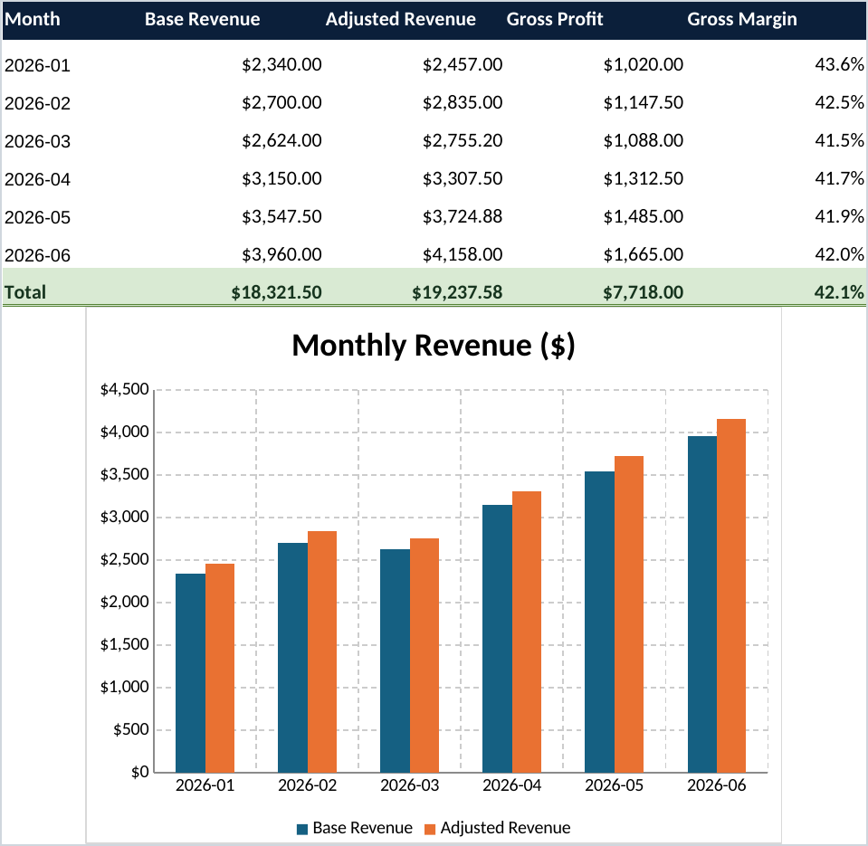
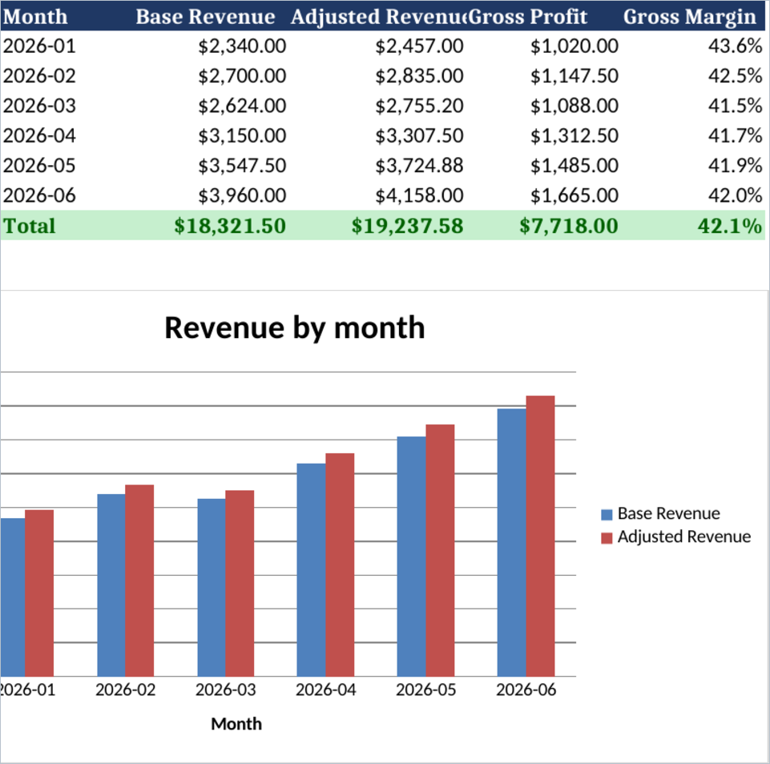
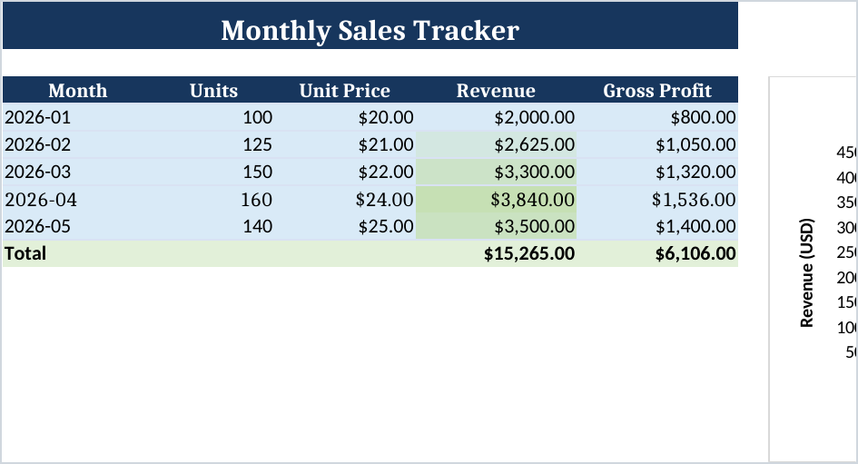
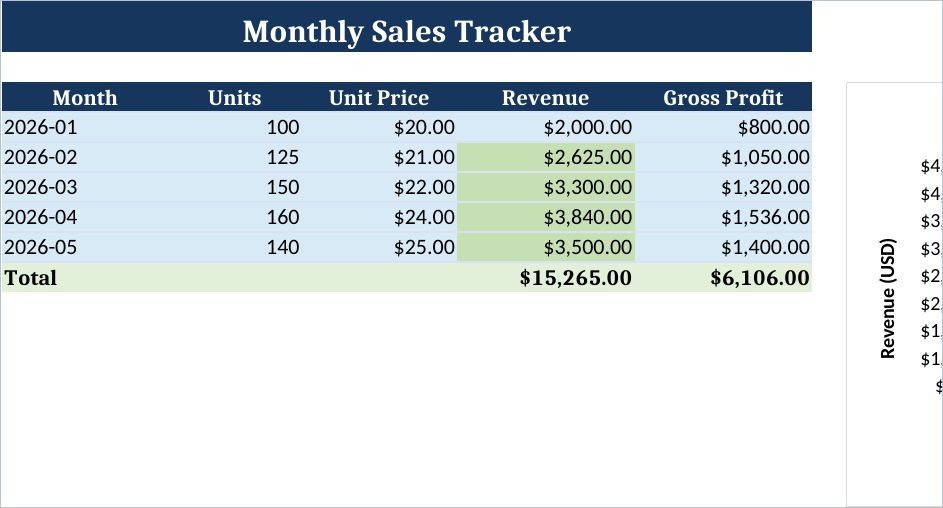

# Local Code spreadsheets skill benchmark

This is a historical benchmark of the former standalone `spreadsheets` skill. The current workflow is [Office's Excel reference](../Resources/Skills/office/references/office-xlsx.md); the recipes and detailed verifier now live under `Resources/Skills/office/`. The prompts, paths, and hashes below describe the original benchmark snapshot.

This benchmark compares GPT-5.6 Sol using the upstream spreadsheet workflow with Qwen 3.8 27B using the Local Code adaptation in this change. Four matched tasks cover workbook creation, preservation-heavy editing, TSV transformation, and read-only diagnosis.

The final result is mixed in a useful way: Qwen passed every independent structural and data check, including the two preservation checks that GPT missed, while GPT was substantially faster and produced the cleaner print layout in the create case. The final Qwen runs were deliberately allowed to finish without a timeout; `caffeinate -dimsu` kept the benchmark host awake throughout.

## Frozen inputs and runtimes

- Base revision: `origin/main` at `ae538112f` when the isolated branch was created.
- GPT baseline: GPT-5.6 Sol with the upstream spreadsheet skill snapshot from package `26.826.12353`. The archived upstream `SKILL.md` SHA-256 was `dec5f25799c0643ef3aa49ed667a134db882253aff90c19076700e2a586fbf8a`.
- Local baseline: Qwen 3.8 27B, 4-bit S checkpoint, through Local Code's production Qwen code-agent, Bash, and PythonIOS tool path. Final runs used deterministic decoding, xhigh reasoning, a 65,536-token thinking budget, and a 131,072-token context window.
- Local spreadsheet packages: openpyxl 3.1.5 and pandas 3.0.5 from the bundled PythonIOS runtime. No package was installed and no network access was used.
- Final Local Code skill revision:

| File | Bytes | SHA-256 |
|---|---:|---|
| `SKILL.md` | 4,731 | `b60299746e7d47c7d6c33ed4a85c2e03cccb60e2fb5268922ec18fd2e198ebc7` |
| `references/openpyxl-recipes.md` | 3,654 | `a16f0c3e8e7568287f08a7ed44ddddae427f878d4ea1dcb11be8d301f065b9d5` |
| `scripts/verify_workbook.py` | 9,456 | `bbc7114009fe159171a7eafedb7511cd02eeb6a3e0c39ae6457aa60fb86587fe` |

The skill was frozen before the four final Qwen runs. No prompt, skill, reference, verifier, decoding, or runtime setting changed between those runs.

## Method

Each run used a fresh task directory. GPT and Qwen received identical task semantics; paths differed only because GPT used the external benchmark workspace while Qwen ran in an isolated Local Code project with `fixtures/` and `outputs/`.

Generated workbooks and raw run logs remain outside Git. The committed evidence consists of this report and four compact PNGs. Every artifact was reopened independently with the bundled workspace Python. XLSX checks covered ZIP integrity, sheets, dimensions, formulas, representative values, styles, tables, conditional formatting, merged ranges, freeze panes, chart references, and formula error tokens. CSV/TSV checks covered UTF-8/tab encoding, schema, identifiers, blanks, rows, calculations, and aggregates. Source hashes were compared before and after edit and diagnosis work.

Workbook screenshots were produced after the model runs with LibreOfficeDev 26.8 in headless mode, converted to PDF, and rasterized to PNG. That renderer is benchmark-only evidence and is not presented as a Local Code runtime capability.

Visible tool calls are agent calls through output completion. GPT token counters were not surfaced and are marked unavailable. Qwen's final context reading is a rough workload indicator, not billable token usage. Its final `prefillTokens` and `generatedTokens` fields are segment-local counters, so they are reported separately and not summed as total tokens.

## Results at a glance

| Task | GPT-5.6 Sol | GPT time / calls / tokens | Qwen 3.8 27B | Qwen time / calls / final context | Main difference |
|---|---|---|---|---|---|
| Create workbook | Partial pass: 13/14 independent checks | 84 s / 11 / unavailable | Structural pass: 14/14 | 1,111.252 s / 21 / 29,013 | GPT omitted required freeze panes and hidden gridlines. Qwen met the structural rubric, but its wide chart crossed the LibreOffice print boundary. |
| Preserve and extend | Partial pass: 11/13 independent checks | 170 s / 22 / unavailable | Pass: 13/13 | 1,850.885 s / 43 / 52,770 | GPT changed layout/style details. Qwen preserved exact source style IDs, widths, panes, table, conditional formatting, and chart ranges. |
| Transform TSV | Pass: 9/9 | 77 s / 9 / unavailable | Pass: 9/9 | 466.248 s / 19 / 17,631 | Outputs are byte-identical. Qwen required more probing and five script patches. |
| Read-only diagnosis | Pass: 6/6 | 66 s / 10 / unavailable | Pass: 6/6 | 551.746 s / 13 / 21,169 | Both found all four root defects and preserved the source. Qwen's report was more detailed but much slower. |

Qwen final segment counters were: create `prefill=287`, `generated=461`; edit `352/565`; transform `140/618`; diagnose `211/940`. These are included only to make future runs comparable under the same Local Code status implementation.

### Broad-prompt follow-up (2026-09-04)

Two additional Qwen-only cases tested whether the frozen skill still works when the user supplies intent rather than a detailed implementation checklist. They used the same deterministic xhigh benchmark harness and bundled PythonIOS runtime as the final runs above. No skill text changed between cases.

| Prompt | Result | Seconds / calls / final context | Evidence |
|---|---|---:|---|
| `Turn fixtures/orders.tsv into a useful Excel sales report for a manager. Save it under outputs/, keep important IDs intact, and check your work before you finish.` | Pass | 617.898 / 13 / 20,948 | Produced a two-sheet formula-driven report with text-preserved IDs, deduplication, normalized statuses, manager KPIs, a chart, and no structural verifier errors. |
| `Add June 2026 to fixtures/styled-monthly-sales.xlsx with 155 units at $26 each. Put the updated workbook under outputs/ and keep it consistent with the existing workbook.` | Partial | 354.570 / 9 / 15,416 | Values, formulas, styles, panes, merge, widths, and source integrity passed, but dependent workbook objects were not extended through June. |

The manager-report artifact is 9,116 bytes with SHA-256 `1675a82fb342d56cc515d7b95b859665d219192a77e43b13beef9c898a17a439`. Independent verification found `Summary` and `Orders`, 35 formulas, one chart, seven unique orders, and text-typed leading-zero IDs. Its recomputed completed-order net sales were `$606.40`. This is strong evidence that Qwen can infer a useful report structure from a short managerial prompt.

The workbook-edit artifact is 8,339 bytes with SHA-256 `fcf6eb6e9cb35c5e835cb4e2b7cb7c05dc41cc7d6ec17503926cb0dffd57227c`. Its June row and moved Total row were correct, but `MonthlySalesTable` remained `A3:E6`, conditional formatting remained `D4:D6`, and chart category/value references remained on rows 4:6 rather than extending through row 7. The current skill already states that `insert_rows` does not update those objects and requires explicit table, conditional-formatting, and chart-reference updates. This failure therefore points to Qwen instruction adherence under ambiguity, not a missing preservation rule.

Both source fixtures retained their original SHA-256 hashes. The two cases support a mixed conclusion: Qwen can generalize from a broad creation prompt, but broad preservation language is not reliably enough to make it execute the full edit checklist.

### Efficiency and probing

| Task | GPT retries | GPT unsupported probes | Qwen non-zero Bash exits | Qwen unsupported commands | Qwen avoidable probing observed |
|---|---:|---:|---:|---:|---|
| Create | 0 | 0 | 3 | 0 | 8 runtime/path probes after the prescribed `/app_bundle` command did not behave as expected in the temporary harness |
| Preserve and extend | 2 | 2 | 7 | 1 (`unzip`) | At least 21: nine runtime/path probes plus twelve raw-OOXML or openpyxl-source probes |
| Transform TSV | 2 | 0 | 4 | 1 (`od`) | Five successive script edits plus one unsupported file-inspection command |
| Read-only diagnosis | 0 | 0 | 5 | 2 (`sha256sum`, `shasum`) | Two hash-command probes and one raw-OOXML inspection beyond the normal workbook pass |

No run modified a source fixture, installed a dependency, used the network, or wrote into the repository. Qwen kept helper scripts and temporary extraction attempts under the allowed `outputs/` directory. Some Qwen final responses incorrectly described direct `python3` as a host fallback; the native harness was linked to and configured with the bundled PythonIOS runtime. This narrative error is counted against verification quality, not scope safety.

## Rubric and scores

Each dimension is scored from 0 to 5: 0 is unusable, 3 is adequate with a material defect or inefficiency, and 5 fully meets the task with strong evidence. `Preservation / types` means source-feature preservation for XLSX editing and data-type/null handling for the other tasks.

| Task / model | Correctness | Auditability / formulas | Preservation / types | Verification | Scope / safety | Efficiency | Total |
|---|---:|---:|---:|---:|---:|---:|---:|
| Create / GPT-5.6 Sol | 4 | 5 | 5 | 2 | 5 | 5 | **26/30** |
| Create / Qwen 3.8 27B | 4 | 5 | 5 | 4 | 5 | 1 | **24/30** |
| Edit / GPT-5.6 Sol | 3 | 5 | 3 | 2 | 5 | 4 | **22/30** |
| Edit / Qwen 3.8 27B | 5 | 5 | 5 | 4 | 5 | 1 | **25/30** |
| Transform / GPT-5.6 Sol | 5 | 5 | 5 | 5 | 5 | 4 | **29/30** |
| Transform / Qwen 3.8 27B | 5 | 5 | 5 | 5 | 5 | 2 | **27/30** |
| Diagnose / GPT-5.6 Sol | 5 | 5 | 5 | 5 | 5 | 5 | **30/30** |
| Diagnose / Qwen 3.8 27B | 5 | 5 | 5 | 5 | 5 | 2 | **27/30** |
| **All tasks / GPT-5.6 Sol** | 17 | 20 | 18 | 14 | 20 | 18 | **107/120** |
| **All tasks / Qwen 3.8 27B** | 19 | 20 | 20 | 18 | 20 | 6 | **103/120** |

The aggregate does not imply that one model dominates. GPT wins decisively on speed and create-case print polish. Qwen wins on exact structural compliance and preservation, but its repeated environment and library introspection is the main remaining weakness.

## Task-by-task evidence

### 1. Formula-driven workbook

Both outputs reopen with `Inputs` and `Summary`, typed source values, 34 formulas, quoted cross-sheet references, money/percent formats, native two-series column charts, and no formula error tokens.

- GPT artifact: 7,227 bytes, SHA-256 `8bc063f2ebf6104d217f57d595c5d12f95d6034948f4b9aeeca75b766785afbb`. Independent failure: neither sheet satisfied the required `A2` freeze-pane plus hidden-gridline combination, despite the run log claiming those properties were confirmed.
- Qwen artifact: 8,089 bytes, SHA-256 `af174c82870cfb95630a8b4080aac566c334e16ec95edc5ba7f7d6609853cf96`. All 14 structural checks passed. LibreOffice recalculated expected totals: base revenue `$18,321.50`, adjusted revenue `$19,237.58`, gross profit `$7,718.00`, and margin `42.1%`. The chart was too wide for one print page, so its left edge is visibly clipped in the second-page evidence.

| GPT-5.6 Sol | Qwen 3.8 27B |
|---|---|
|  |  |

### 2. Preservation-heavy workbook edit

Both outputs add April and May before Total, extend formulas through row 8, move Total to row 9, expand `MonthlySalesTable` to `A3:E8`, extend conditional formatting to `D4:D8`, and update native chart categories/values through row 8. Both source hashes remained `ed20d405dc9469890e89e51c9d28f56401d1e2877c8c73103d2e9bff9d4cd030`.

- GPT artifact: 7,880 bytes, SHA-256 `03e7ba723987e9be748994480ad1ab3ebcab8ecf3fc867e3a21955cded71fc5e`. It passed formula, table, conditional-formatting, chart, sheet, and source-integrity checks, but failed exact layout preservation and source-row/total style-ID comparison. Its own run log notes that the imported conditional-format object was replaced with a visually matching two-color scale and that freeze panes could not be queried directly.
- Qwen artifact: 8,375 bytes, SHA-256 `663bddba85fd87b1f6253b13cc14b5ef822e0ffb575b84e7fc590d756da1e24b`. It passed all 13 independent checks, including exact style-ID extension, unchanged original cells, `A4` freeze panes, widths A:F, merged `A1:E1`, table, original conditional-format rule, and chart references.

| GPT-5.6 Sol | Qwen 3.8 27B |
|---|---|
|  |  |

### 3. TSV transformation

Both models produced the same 520-byte file with SHA-256 `bbbf83ace988bfe1975532aecbbe90a3071664e18a601b79a27a21859cb86405`. It has the original eight columns plus `net_amount`, seven rows after removing one exact duplicate, preserved six-digit account IDs and four-digit order IDs, lowercase statuses, three blank discounts, stable order, and two-decimal money values.

The grand net total is `$847.40`; regional totals are North `$336.00`, South `$325.00`, West `$186.40`; status totals are complete `$606.40`, pending `$166.00`, cancelled `$75.00`.

### 4. Read-only diagnosis

Both reports end with `needs revision`, identify all four planted root defects, distinguish cascading `#REF!` effects, and leave the fixture hash unchanged at `366ac1202338de52206c6b83f0ac8b4d9e2482c79ddca01a3ca048bfabea7f56`.

The four root defects are:

1. `Forecast!D4`: `=B4*#REF!` instead of `=B4*C4`.
2. `Forecast!D5`: `=SUM(D2:D3)` omits March and should be `=SUM(D2:D4)`.
3. `Forecast!G3`: `=F3/D2` uses January revenue and should be `=F3/D3`.
4. `Inputs!B4`: text `12%` should be numeric `0.12` with a percent number format.

GPT's 2,469-byte report SHA-256 is `08d59ca051cb143e567883b06f5648c3f585173c7ea3ad8467f58eb274b87f4d`. Qwen's more detailed 5,515-byte report SHA-256 is `459a49378538131d2708f5a5c8fe9f4fb636096224b2830e9a19e7324f4f9037`.

## Iteration history

### Initial Local Code adaptation

The first adaptation used openpyxl/pandas generically but did not pin bundled versions, explain the virtual `/app_bundle` working directory, constrain script reuse, or explicitly warn against environment and OOXML/library-source exploration. All four initial Qwen GUI artifacts passed the independent result checks, but the runs were slow and relied on a host-style Python fallback:

| Case | Seconds | Calls | Final context | Artifact bytes / SHA-256 |
|---|---:|---:|---:|---|
| Create | 720.589 | 30 | 32,839 | 8,126 / `8da57182d56dfc8661bbadb94d9f9f35112e6f07a815a0fc1232ae3139cdd50d` |
| Edit | 1,278.503 | 42 | 55,539 | 8,362 / `34e477f89077b2f2f4e7173720758a866428f45a69e98434f242bbe98dff54a5` |
| Transform | 220.597 | 7 | 22,241 | 520 / `bbbf83ace988bfe1975532aecbbe90a3071664e18a601b79a27a21859cb86405` |
| Diagnose | 570.567 | 15 | 34,244 | 5,559 / `6eee5494966b28cadc84b294f8e8fbdc7ba1a7dfd3d1c7aa0a9764bc4a7d01bd` |

### Evidence-supported skill changes

The final revision added only guidance tied to observed failures or inefficiency:

- pinned openpyxl 3.1.5 and pandas 3.0.5 and prohibited installs;
- supplied the exact same-call `/app_bundle` invocation and explained that it is a virtual `cd` destination;
- instructed the model to keep one reusable output script, patch it, and avoid searching for runtimes, site-packages, app bundles, or other projects;
- expanded the edit checklist to include formulas, styles, formats, merged ranges, dimensions, panes, tables, validation, conditional formatting, names, and chart ranges;
- stated explicitly that `insert_rows` does not update dependent workbook objects and added direct table/conditional-format/chart-reference recipes;
- made identifier, missing-value, delimiter, encoding, and `lineterminator` handling explicit for CSV/TSV;
- strengthened the verifier with `--project-root`, containment checks, style counts, pane/table/conditional-format/data-validation reports, chart anchors and series references, representative cells, ZIP integrity, and error-token scanning;
- prohibited whole-package OOXML and library-source inspection when normal workbook properties are sufficient;
- separated structural verification from actual visual rendering and reiterated that openpyxl does not recalculate formulas.

### Harness and decoding issue

The normal GUI automation path began hanging while opening the Qwen checkpoint. A native Qwen evaluation CLI loaded the same 20 GB checkpoint and generated successfully, isolating the hang to GUI automation rather than the model file. Final runs therefore used a temporary, uncommitted benchmark CLI wired to the production Local Code code-agent, skill catalog, Bash tools, and PythonIOS runtime. The harness was removed before this change was tested.

With nondeterministic decoding, a create attempt succeeded in 598.098 seconds with 12 calls and 18,850 context tokens after punctuation in several tool calls was malformed and repaired. An edit attempt stopped after 31.012 seconds and two calls on a malformed `<function=bash>!` delimiter. Deterministic decoding eliminated that corruption. No skill text was changed between deterministic final cases.

The final runs show that deterministic decoding solved the hard tool-call failure, but did not solve excessive path/runtime probing or low-level workbook introspection. Those remain agent/model adherence issues because the frozen skill explicitly tells the model not to perform them.

## Fixtures

| Fixture | Definition | Bytes | SHA-256 |
|---|---|---:|---|
| `styled-monthly-sales.xlsx` | `Monthly Sales` plus `Assumptions`; three data rows; formulas; `A3:E6` table; `D4:D6` cell-is conditional formatting; `A4` freeze pane; fixed A:F widths; merged title; native line chart | 8,297 | `ed20d405dc9469890e89e51c9d28f56401d1e2877c8c73103d2e9bff9d4cd030` |
| `orders.tsv` | Eight rows including one exact duplicate, leading-zero identifiers, mixed status casing, ISO dates, three blank discounts, and a blank note | 523 | `47f04564008353b20509565000d2770057cfbe2f0ab3a1d27d0a5d9f6b04aff1` |
| `forecast-review.xlsx` | Two sheets with one percentage stored as text, a wrong denominator, a broken reference, and an off-by-one total | 6,160 | `366ac1202338de52206c6b83f0ac8b4d9e2482c79ddca01a3ca048bfabea7f56` |

TSV fixture values (`<blank>` denotes a zero-length field):

```tsv
order_id	account_id	order_date	region	status	gross_amount	discount_rate	note
0001	000123	2026-01-03	North	complete	100.00	0.10	new
0002	000124	2026-01-04	South	COMPLETE	250.00		priority
0003	000123	2026-01-05	North	pending	80.00	0.05	review
0004	000125	2026-01-06	West	Complete	120.50	0.20	<blank>
0005	000126	2026-01-07	South	CANCELLED	75.00		customer request
0006	000127	2026-01-08	North	complete	200.00	0.15	renewal
0006	000127	2026-01-08	North	complete	200.00	0.15	renewal
0007	000128	2026-01-09	West	pending	90.00		follow up
```

## Exact prompts

Prompt files were used verbatim. Their SHA-256 hashes are listed after each prompt so later revisions can detect accidental edits.

<details>
<summary>GPT create prompt — SHA-256 e9a39ae5fd3cfc7f5a83b5c6be93a913903ebdeca7bb67dd94085eb0836d45ce</summary>

```text
$spreadsheets

Create a formula-driven Excel workbook at `spreadsheets-benchmark-20260903/gpt/create/revenue-model.xlsx`. Work only inside `spreadsheets-benchmark-20260903/gpt/create`; do not edit the repository, install dependencies, use the network, or write anywhere else.

Use exactly this data on an `Inputs` sheet with headers `Month`, `Units`, `Unit Price`, `Unit Cost` in A1:D1:

- 2026-01, 120, 19.50, 11.00
- 2026-02, 135, 20.00, 11.50
- 2026-03, 128, 20.50, 12.00
- 2026-04, 150, 21.00, 12.25
- 2026-05, 165, 21.50, 12.50
- 2026-06, 180, 22.00, 12.75

Put `Assumption` and `Value` in F1:G1, `Scenario uplift` in F2, and numeric 5% in G2. Do not hardcode derived results.

Create a `Summary` sheet with headers `Month`, `Base Revenue`, `Adjusted Revenue`, `Gross Profit`, `Gross Margin` in A1:E1. Rows 2:7 must use formulas, including quoted cross-sheet references: month from Inputs, base revenue as units times unit price, adjusted revenue using the uplift assumption in Inputs!G2, gross profit as units times unit price minus unit cost, and gross margin as gross profit divided by base revenue. Row 8 must be `Total` with formulas in B:E; total gross margin must be total gross profit divided by total base revenue.

Use typed numeric values, currency formats for prices and money, percentage formats for uplift and margins, dark navy headers, light-blue editable input cells, a green total row, sensible widths, frozen header rows, and hidden gridlines. Add a native column chart on `Summary` using months A2:A7 as categories and at least base revenue B2:B7 as a series; including adjusted revenue is welcome.

Reopen and structurally verify the workbook. In the final response, give the output path and a concise verification summary.
```
</details>

<details>
<summary>Qwen create prompt — SHA-256 5a0779ce2f3dcc08b221bcb396d86cf306641efef66531db60c25793fc337e60</summary>

```text
$spreadsheets

Create a formula-driven Excel workbook at `outputs/revenue-model.xlsx`. Work only inside `outputs`; do not edit the repository, install dependencies, use the network, or write anywhere else.

Use exactly this data on an `Inputs` sheet with headers `Month`, `Units`, `Unit Price`, `Unit Cost` in A1:D1:

- 2026-01, 120, 19.50, 11.00
- 2026-02, 135, 20.00, 11.50
- 2026-03, 128, 20.50, 12.00
- 2026-04, 150, 21.00, 12.25
- 2026-05, 165, 21.50, 12.50
- 2026-06, 180, 22.00, 12.75

Put `Assumption` and `Value` in F1:G1, `Scenario uplift` in F2, and numeric 5% in G2. Do not hardcode derived results.

Create a `Summary` sheet with headers `Month`, `Base Revenue`, `Adjusted Revenue`, `Gross Profit`, `Gross Margin` in A1:E1. Rows 2:7 must use formulas, including quoted cross-sheet references: month from Inputs, base revenue as units times unit price, adjusted revenue using the uplift assumption in Inputs!G2, gross profit as units times unit price minus unit cost, and gross margin as gross profit divided by base revenue. Row 8 must be `Total` with formulas in B:E; total gross margin must be total gross profit divided by total base revenue.

Use typed numeric values, currency formats for prices and money, percentage formats for uplift and margins, dark navy headers, light-blue editable input cells, a green total row, sensible widths, frozen header rows, and hidden gridlines. Add a native column chart on `Summary` using months A2:A7 as categories and at least base revenue B2:B7 as a series; including adjusted revenue is welcome.

Reopen and structurally verify the workbook. In the final response, give the output path and a concise verification summary.
```
</details>

<details>
<summary>GPT edit prompt — SHA-256 68f7993389d2b709d2b8e27b500285e79df78af0f3c2cce757759e93e7269061</summary>

```text
$spreadsheets

Without modifying the source file `spreadsheets-benchmark-20260903/fixtures/styled-monthly-sales.xlsx`, create `spreadsheets-benchmark-20260903/gpt/edit/styled-monthly-sales-extended.xlsx`. Work only inside `spreadsheets-benchmark-20260903/gpt/edit`; do not edit the repository, install dependencies, use the network, or write anywhere else.

On `Monthly Sales`, insert two months immediately before the Total row:

- 2026-04 with Units 160 and Unit Price 24
- 2026-05 with Units 140 and Unit Price 25

Preserve the source workbook's sheets, original cell values and formulas, title/header/input/total formatting, number formats, freeze panes, column widths, merged ranges, table, conditional formatting, and native chart. Extend the existing formula and style patterns into the two new rows. Move the Total row after them and update its formulas. Expand `MonthlySalesTable`, the revenue conditional-formatting range, and the chart's category and revenue ranges through the new data rows. Do not replace formulas with values and do not create a chart image.

Reopen and structurally verify the output. In the final response, give the source and output paths and a concise preservation/verification summary.
```
</details>

<details>
<summary>Qwen edit prompt — SHA-256 a41cc58d579812e386559ca3b89bcf0b2510f1368bbf813aa7488a58dcce510d</summary>

```text
$spreadsheets

Without modifying the source file `fixtures/styled-monthly-sales.xlsx`, create `outputs/styled-monthly-sales-extended.xlsx`. Work only inside `outputs` except for reading the source; do not edit the repository, install dependencies, use the network, or write anywhere else.

On `Monthly Sales`, insert two months immediately before the Total row:

- 2026-04 with Units 160 and Unit Price 24
- 2026-05 with Units 140 and Unit Price 25

Preserve the source workbook's sheets, original cell values and formulas, title/header/input/total formatting, number formats, freeze panes, column widths, merged ranges, table, conditional formatting, and native chart. Extend the existing formula and style patterns into the two new rows. Move the Total row after them and update its formulas. Expand `MonthlySalesTable`, the revenue conditional-formatting range, and the chart's category and revenue ranges through the new data rows. Do not replace formulas with values and do not create a chart image.

Reopen and structurally verify the output. In the final response, give the source and output paths and a concise preservation/verification summary.
```
</details>

<details>
<summary>GPT transform prompt — SHA-256 25f8c136b830fcfb88b188e88b063c6a0c91e09ac2bd0ef2d16430f364458fce</summary>

```text
$spreadsheets

Transform `spreadsheets-benchmark-20260903/fixtures/orders.tsv` into `spreadsheets-benchmark-20260903/gpt/transform/orders-clean.tsv`. Work only inside `spreadsheets-benchmark-20260903/gpt/transform`; do not modify the source, edit the repository, install dependencies, use the network, or write anywhere else.

Read and write UTF-8 tab-separated text. Preserve the original column order and append `net_amount`. Treat `account_id` as text so every leading zero survives. Preserve ISO date strings. Remove only exact duplicate rows, keeping the first occurrence. Normalize `status` values to lowercase. Preserve blank `discount_rate` fields as blank in the output; treat a blank discount as zero only while calculating `net_amount = gross_amount * (1 - discount_rate)`. Write monetary results with exactly two decimal places and keep the row order otherwise stable.

Verify delimiter, schema, deduplicated row count, leading-zero identifiers, blank-value semantics, representative rows, and aggregate totals. In the final response, give the output path, row count, grand total, and totals by region and normalized status.
```
</details>

<details>
<summary>Qwen transform prompt — SHA-256 7d6b99acb21fb2e30fa66174a07c0328955aab66b7e12fb9bc7f0962b81b74eb</summary>

```text
$spreadsheets

Transform `fixtures/orders.tsv` into `outputs/orders-clean.tsv`. Work only inside `outputs` except for reading the source; do not modify the source, edit the repository, install dependencies, use the network, or write anywhere else.

Read and write UTF-8 tab-separated text. Preserve the original column order and append `net_amount`. Treat `account_id` as text so every leading zero survives. Preserve ISO date strings. Remove only exact duplicate rows, keeping the first occurrence. Normalize `status` values to lowercase. Preserve blank `discount_rate` fields as blank in the output; treat a blank discount as zero only while calculating `net_amount = gross_amount * (1 - discount_rate)`. Write monetary results with exactly two decimal places and keep the row order otherwise stable.

Verify delimiter, schema, deduplicated row count, leading-zero identifiers, blank-value semantics, representative rows, and aggregate totals. In the final response, give the output path, row count, grand total, and totals by region and normalized status.
```
</details>

<details>
<summary>GPT diagnosis prompt — SHA-256 6dadaf6fb5bce39b812cfae2f100968537b7ba7074db8df4e06db00f72b0e8fe</summary>

```text
$spreadsheets

Perform a read-only diagnosis of `spreadsheets-benchmark-20260903/fixtures/forecast-review.xlsx`. Do not modify or replace the workbook and do not create another workbook. Write the diagnosis to `spreadsheets-benchmark-20260903/gpt/diagnose/diagnosis.md`. Work only inside `spreadsheets-benchmark-20260903/gpt/diagnose`; do not edit the repository, install dependencies, use the network, or write anywhere else.

Inspect formulas, values, types, and number formats. Identify the root defects and distinguish them from downstream or cascading effects. For every finding, provide priority, exact sheet/cell, current content, why it is wrong, and a concrete correction. End with exactly one readiness verdict: `ready`, `share with caveats`, or `needs revision`.

Verify that the source file hash is unchanged. In the final response, give the report path, verdict, root-defect count, and source-integrity result.
```
</details>

<details>
<summary>Qwen diagnosis prompt — SHA-256 2152afdb9dd856cad01e6585a43129de01aa2a8787d8e825ecf55abd42ff716e</summary>

```text
$spreadsheets

Perform a read-only diagnosis of `fixtures/forecast-review.xlsx`. Do not modify or replace the workbook and do not create another workbook. Write the diagnosis to `outputs/diagnosis.md`. Work only inside `outputs` except for reading the source; do not edit the repository, install dependencies, use the network, or write anywhere else.

Inspect formulas, values, types, and number formats. Identify the root defects and distinguish them from downstream or cascading effects. For every finding, provide priority, exact sheet/cell, current content, why it is wrong, and a concrete correction. End with exactly one readiness verdict: `ready`, `share with caveats`, or `needs revision`.

Verify that the source file hash is unchanged. In the final response, give the report path, verdict, root-defect count, and source-integrity result.
```
</details>

## Reproduction and validation

Local Code project scripts should use the bundled runtime in a single Bash call:

```sh
PROJECT_ROOT="$PWD"; cd /app_bundle && python3 "$PROJECT_ROOT/outputs/workbook_task.py"
```

The committed verifier is invoked similarly:

```sh
PROJECT_ROOT="$PWD"; cd /app_bundle && python3 Skills/spreadsheets/scripts/verify_workbook.py \
  --project-root "$PROJECT_ROOT" outputs/result.xlsx
```

Repository validation for this change:

```sh
bazel test //Apps/LocalCode:SkillCatalogTests
bazel build //Apps/LocalCode:LocalCode --ios_multi_cpus=arm64
python3 -m py_compile Apps/LocalCode/Resources/Skills/spreadsheets/scripts/verify_workbook.py
git diff --check
```

Final results: Python syntax and both create/edit verifier smoke checks passed; `SkillCatalogTests` passed; the arm64 Local Code build completed successfully (1,520 actions); and the staged diff passed `git diff --check`.

The Python verifier is structural. It cannot calculate formulas or prove visual fidelity. Formula results in this report came only from arithmetic cross-checks or the external LibreOffice rendering pass. Raw workbooks, fixtures, temporary scripts, model transcripts, and transient render products are intentionally not committed.

Screenshot hashes:

| Evidence | SHA-256 |
|---|---|
| `gpt56-create.png` | `7f5e38cef346a74812f92fba0c5eb67f3a638ec87171a7b5c48e5a69b838c40d` |
| `qwen-create.png` | `a3c61a331c6f9c516ef43f7d0fb6bcd0e35eff1316d7321a27c99889b4f9a345` |
| `gpt56-edit.png` | `9a95758c397f7fb81697a1fb6f73a9fc4eafa3f104f7476eeb495dd44a784359` |
| `qwen-edit.png` | `49fdd7d6a1519eebd2a18dc6384efdf4ab59b7b4e84cb86d6e1e7a61691fb4ef` |
