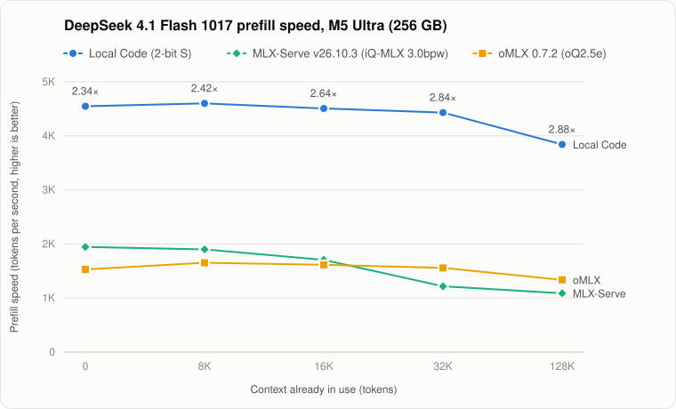
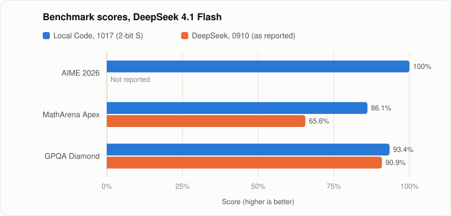
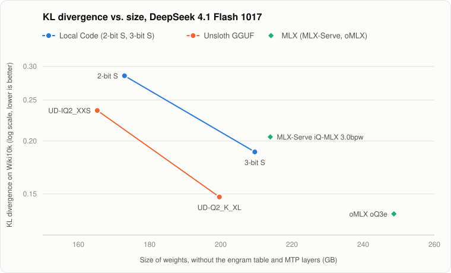
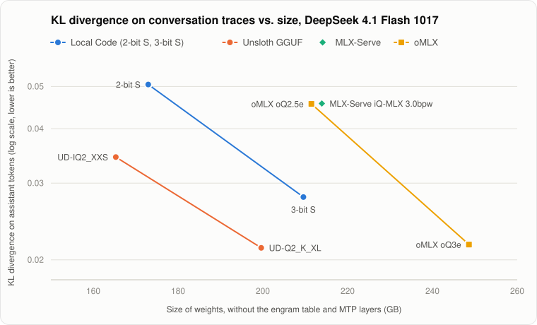
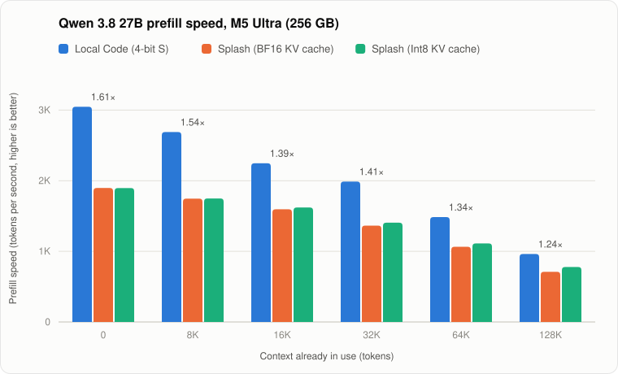

# Local Code

Local Code is a private AI agent for Mac, iPad and iPhone, written mostly in Swift. It puts three things in one app: an LLM inference engine for Apple Silicon, a coding harness tuned to each model, and an agent runtime with Python, Node.js, a shell and other familiar tools built in. With these, the agent can work through whole tasks on files you choose, such as analyzing data, charting it, writing documents and slide decks, or building software.

With an on-device quasi-frontier model, such as DeepSeek 4.1 Flash 1017, inference runs on your device and works offline. You can also pick a cloud model from Anthropic, OpenAI, OpenRouter or an OpenAI-compatible server. When you do, your prompts, file contents and tool output go to that provider. Either way, the agent's tools run inside the app's sandbox and can reach only the folders you allow.

Download Local Code from [getlocalcode.app](https://getlocalcode.app).

This repository contains the source code of the app and its command-line tools, along with the libraries and vendored dependencies they are built from.

## An Agent That Does Real Work

An agent that does real work needs more than an inference engine, a harness and a model. It also needs what people expect from well-made software:

- **Durable tasks and threads:** tasks and chat threads are saved, so you can close the app and pick them up later.
- **Resumable generation:** an interrupted reply, reasoning included, continues where it stopped instead of starting over.
- **Steering:** you can send a message at any time, even while the agent is working, to change its course.
- **Long-term context cache:** the model's context is saved to disk, including images and the recurrent state that some models keep, so a long conversation isn't read again from the start.

The engine and the model still matter, and the rest of this section covers them: the models, the sandbox the agent works in, and how fast and how accurately the models run.

### Models

Local Code downloads its own quantized checkpoints of each model:

| Model | Quantizations | Input | Download size |
| --- | --- | --- | --- |
| DeepSeek 4.1 Flash 1017 | 2-bit S, 3-bit S | Text and images | 376 GB, 412 GB |
| DeepSeek 4 Flash 0731 | 2-bit S | Text | 89.4 GB |
| Qwen 3.8 27B | 2-bit S, 4-bit S, 8-bit S | Text and images | 9.6 GB, 21.3 GB, 29.2 GB |

The DeepSeek 4.1 Flash 1017 sizes include a 203 GB engram file, which both of its quantizations share.

The DeepSeek models are mixtures of experts, and they are larger than the memory of most Macs. For example, the DeepSeek 4.1 Flash 1017 (2-bit S) checkpoint is about 173 GB. Local Code keeps as many of the most used experts in memory as there is room for, and streams the rest from disk. It also leaves room for the other apps you run. The experts kept in memory never take more than the Mac's memory minus 32 GB, or more than 72% of the memory that is free when the model loads. So these models run on Macs with less memory than the checkpoint, run faster the more memory there is, and leave the rest of the Mac usable.

During setup, Local Code suggests a model based on the device's memory:

- under 32 GB: Qwen 3.8 27B (2-bit S)
- 32 GB and up: Qwen 3.8 27B (4-bit S)
- 48 GB and up: DeepSeek 4 Flash 0731
- 64 GB and up: DeepSeek 4.1 Flash 1017

You can switch to any model later.

### The In-App Sandbox

Local Code doesn't run the agent's commands as separate programs on your computer. The shell, the language runtimes and the command-line tools are compiled into the app and run in its own process, inside Apple's App Sandbox. On a Mac, the Hardened Runtime also protects the app's code. The agent has no full-disk access, and it can't launch other programs on your computer, so it can't run native programs that aren't built into the app.

Each project is a folder inside a workspace that you choose. The agent starts in the project folder and can read and write anywhere in the workspace, plus the app's temporary folder. Packages and caches that the agent installs for a project stay in that project's folder. Commands that use the network, such as web search, `curl` and `ssh`, connect out when the agent runs them.

The sandbox includes:

- **Shell:** OSH from [Oils](https://oils.pub), with common Unix commands such as `grep`, `sed`, `awk`, `find`, `diff`, `rg`, `jq`, `zip`, `curl`, `git` and `ssh`.
- **Python 3.14:** NumPy, pandas, Matplotlib, Pillow, lxml, openpyxl, python-docx, python-pptx and pypdf, and `pip` for more.
- **Node.js 24:** `npm` and `npx`.
- **Lean 4 and Z3:** to check proofs and solve constraint problems. Lean can also install Mathlib.
- **Documents and media:** LibreOffice, through the `office` command, to convert and render Word, Excel, PowerPoint and PDF files. Also FFmpeg, plus `html2video` and `hyperframes` to make videos from HTML.
- **Web:** web search, and a WebKit browser that the agent can drive to test pages or to use sites that need JavaScript or a sign-in.
- **Images and video:** the Draw Things CLI, to generate images and videos.
- **Personal data:** `calendar` to read and edit events, and `photos` to find, import, edit and organize photos and videos. On a Mac, `notes`, `mail` and `imessage` also read Notes, Mail and Messages, but they can't change or send anything. Each command works only after you grant access.

Built-in skills show the agent how to use these tools for common work:

| Skill | Use |
| --- | --- |
| [`office`](Apps/LocalCode/Resources/Skills/office) | Create, read, edit and check Word, PowerPoint and Excel files and CSV or TSV tables, and export them to PDF or images |
| [`answers-charts`](Apps/LocalCode/Resources/Skills/answers-charts) | Draw data charts with Python and Matplotlib, shown inline in the answer |
| [`hyperframes`](Apps/LocalCode/Resources/Skills/hyperframes) | Make motion graphics and timed HTML compositions, such as animated text, captions and slideshows, and render them to video |
| [`use-draw-things-cli`](Apps/LocalCode/Resources/Skills/use-draw-things-cli) | Generate and edit images, and create videos, with the Draw Things CLI |
| [`use-web-browse-cli`](Apps/LocalCode/Resources/Skills/use-web-browse-cli) | Drive the WebKit browser to test pages, or to use sites that need JavaScript or a sign-in |
| [`deploy-static-site-with-wrangler`](Apps/LocalCode/Resources/Skills/deploy-static-site-with-wrangler) | Publish a folder of static web files to a temporary public URL with Cloudflare Wrangler |
| [`use-mcp-with-mcporter`](Apps/LocalCode/Resources/Skills/use-mcp-with-mcporter) | Connect to Model Context Protocol servers and call their tools through MCPorter |
| [`check_lean-and-lean-tools`](Apps/LocalCode/Resources/Skills/check_lean-and-lean-tools) | Prove non-obvious claims about code, such as ones about recursive functions or data structures, with Lean |
| [`skill-creator`](Apps/LocalCode/Resources/Skills/skill-creator) | Create, import, update and validate skills |
| [`introduce-local-code`](Apps/LocalCode/Resources/Skills/introduce-local-code) | Explain what Local Code is and what the agent can do |

You can add your own skills to a project's `.agents/skills` folder.

### Performance on Macs

Speeds are in tokens per second, given as prefill / decode. Each column starts with that much context already in use. On top of it, Local Code prefills one more full chunk, and separately decodes 128 tokens. A chunk is the most Local Code prefills at once on that Mac: 4,096 tokens on the M5 Max, and 8,192 on the M5 Ultra.

**M5 Max, 128 GB**

| Model | 8K already in context | 16K already in context | 32K already in context | 128K already in context |
| --- | --- | --- | --- | --- |
| Qwen 3.8 27B (4-bit S) | 1,450 / 40.4 | 1,296 / 35.0 | 1,005 / 27.9 | 456 / 13.5 |
| DeepSeek 4 Flash 0731 (2-bit S) | 1,361 / 42.3 | 1,316 / 41.7 | 1,237 / 40.9 | 924 / 36.7 |
| DeepSeek 4.1 Flash 1017 (2-bit S) | 346 / 18.7 | 339 / 17.1 | 339 / 17.2 | 355 / 15.7 |

On the M5 Max, the DeepSeek 4.1 Flash 1017 readings set Weights Streaming to 56 GiB (`--weights-streaming 56` in the CLI). DeepSeek 4 Flash 0731 keeps all of its weights in memory.

**M5 Ultra, 256 GB**

| Model | 8K already in context | 16K already in context | 32K already in context | 128K already in context |
| --- | --- | --- | --- | --- |
| Qwen 3.8 27B (4-bit S) | 2,689 / 54.5 | 2,247 / 44.0 | 1,988 / 33.2 | 962 / 12.2 |
| DeepSeek 4 Flash 0731 (2-bit S) | 3,384 / 56.2 | 3,265 / 55.9 | 3,039 / 54.7 | 2,087 / 50.4 |
| DeepSeek 4.1 Flash 1017 (2-bit S) | 4,600 / 58.9 | 4,507 / 58.6 | 4,431 / 57.9 | 3,840 / 56.1 |

On the M5 Ultra, both DeepSeek readings are a second pass in the same session, without the 20-second cool-down before each prefill. For DeepSeek 4.1 Flash 1017, its engram entries are also already in memory.

This chart compares DeepSeek 4.1 Flash 1017 prefill speed on the same M5 Ultra in Local Code, in MLX-Serve v26.10.3 with the iQ-MLX 3.0bpw checkpoint, and in oMLX 0.7.2 with the oQ2.5e checkpoint. Each reading times only the prefill of an 8,192-token chunk on top of the given amount of context. The Local Code readings come from the same runs as the table above, and the MLX-Serve and oMLX readings, both with CED on, are medians of three runs. The label above each Local Code point is how much faster it is than the faster of MLX-Serve and oMLX at that context length.

<picture>
  <source media="(prefers-color-scheme: dark)" srcset=".github/images/prefill-vs-mlx-dark.svg">
  
</picture>

<details>
<summary>Data</summary>

Speeds are in tokens per second.

| Context in use | Local Code (2-bit S) | MLX-Serve v26.10.3 (iQ-MLX 3.0bpw) | oMLX 0.7.2 (oQ2.5e) |
| --- | --- | --- | --- |
| 0 | 4,547 | 1,945 | 1,529 |
| 8K | 4,600 | 1,900 | 1,653 |
| 16K | 4,507 | 1,706 | 1,615 |
| 32K | 4,431 | 1,217 | 1,558 |
| 128K | 3,840 | 1,087 | 1,335 |

</details>

To measure your own Mac, open Model Speed in the app, or run the same measurements, at context lengths up to the model's limit, with the CLI:

```bash
bazel run -c opt //Apps/LocalCode:LocalCodeCLI -- speedometer \
  --model qwen_3.8_27b_i4x.ckpt --result-json /path/to/speed.json
```

### Benchmarks

This chart compares DeepSeek 4.1 Flash 1017 (2-bit S) in Local Code with the scores DeepSeek reported for DeepSeek 4.1 Flash 0910:

<picture>
  <source media="(prefers-color-scheme: dark)" srcset=".github/images/benchmarks-dark.svg">
  
</picture>

| Benchmark | [DeepSeek 4.1 Flash 0910](https://huggingface.co/deepseek-ai/DeepSeek-V4.1-Flash) (as reported) | DeepSeek 4.1 Flash 0910 (2-bit S) | DeepSeek 4.1 Flash 1017 (2-bit S) |
| --- | --- | --- | --- |
| AIME 2026 | — | 30/30 (100%) | 30/30 (100%) |
| MathArena Apex | 65.6% | 7/12 (58.3%) | 10.3/12 (86.1%) |
| GPQA Diamond | 90.9% | 179/198 (90.4%) | 185/198 (93.4%) |

Reported scores are from the model card, at maximum reasoning effort. The 2-bit S MathArena Apex scores average several runs of its 12 problems: two for 0910 and three for 1017.

Average reasoning tokens per attempt:

| Benchmark | DeepSeek 4.1 Flash 0910 (as reported) | DeepSeek 4.1 Flash 0910 (2-bit S) | DeepSeek 4.1 Flash 1017 (2-bit S) |
| --- | --- | --- | --- |
| AIME 2026 | — | 15,710 | 16,909 |
| MathArena Apex | — | 161,725 | 120,657 |
| GPQA Diamond | — | 31,042 | 22,103 |

### Quantization Quality

KL divergence (KLD) measures how far a quantized model's predictions drift from the original model's. Lower is closer. These charts compare the KLD of DeepSeek 4.1 Flash 1017 quantizations against the size of their weights, on two datasets: Wiki10k, and conversation traces (only assistant tokens).

<picture>
  <source media="(prefers-color-scheme: dark)" srcset=".github/images/kld-vs-size-dark.svg">
  
</picture>

<picture>
  <source media="(prefers-color-scheme: dark)" srcset=".github/images/kld-conversation-traces-vs-size-dark.svg">
  
</picture>

Sizes leave out the engram table and the MTP layers. The checkpoints store the engram table at different precisions, and only the MLX checkpoints include MTP layers.

<details>
<summary>Data</summary>

| Checkpoint | Size of weights | KLD, Wiki10k | KLD, conversation traces (only assistant tokens) |
| --- | --- | --- | --- |
| Local Code 2-bit S | 173.0 GB | 0.28516 | 0.050512 |
| Local Code 3-bit S | 209.6 GB | 0.18850 | 0.027868 |
| Unsloth UD-IQ2_XXS | 165.3 GB | 0.23621 | 0.034424 |
| Unsloth UD-Q2_K_XL | 199.6 GB | 0.14755 | 0.021310 |
| MLX-Serve iQ-MLX 3.0bpw | 213.9 GB | 0.20453 | 0.045695 |
| oMLX oQ2.5e | 211.5 GB | 0.26888 | 0.045604 |
| oMLX oQ3e | 248.6 GB | 0.13462 | 0.021685 |

</details>

### Qwen 3.8 27B

Qwen 3.8 27B is a small model that understands images, and it is strong at coding and long-horizon work. Local Code suggests it for devices with less than 48 GB of memory.

#### Prefill Speed

Before a model writes its first token, it has to read the whole prompt. For an agent, that means the conversation so far, the files it has opened and the output of its tools. This step is called prefill. Each tool call adds to the context, so in agent work, prefill is often what you wait for.

The chart compares prefill speed in Local Code and in [Splash](https://github.com/incoai/splash), an open-source inference engine for Apple silicon, on an M5 Ultra with 256 GB of memory. Splash runs the model's UD-Q4_K_XL GGUF checkpoint. Each reading prefills an 8,192-token chunk after the given amount of context is already in use. The label above each Local Code point is how much faster it is than the faster of the two Splash settings.

<picture>
  <source media="(prefers-color-scheme: dark)" srcset=".github/images/prefill-vs-splash-dark.svg">
  
</picture>

<details>
<summary>Data</summary>

Speeds are in tokens per second.

| Context in use | Local Code (4-bit S) | Splash (BF16 KV cache) | Splash (Int8 KV cache) |
| --- | --- | --- | --- |
| 0 | 3,048 | 1,897 | 1,896 |
| 8K | 2,689 | 1,747 | 1,749 |
| 16K | 2,247 | 1,596 | 1,621 |
| 32K | 1,988 | 1,364 | 1,406 |
| 64K | 1,485 | 1,065 | 1,112 |
| 128K | 962 | 710 | 778 |

</details>

Splash decodes faster than Local Code because it drafts tokens with the DFlash2 draft model. This comparison leaves decode out, because it compares how the two engines implement attention.

#### Why Local Code Prefills Faster

As the context grows, the extra prefill time goes to attention. For each new token, attention does two large matrix multiplications against every earlier token:

- **QK:** the new token's query (Q) is multiplied with the key (K) of each earlier token, which scores how relevant that token is.
- **PV:** those scores (P) are used to take a weighted sum of the earlier tokens' values (V).

Both grow with the length of the context, so at 64K or 128K tokens they take a large share of the prefill time.

The GPUs in Apple's M5 chips and later multiply two Int8 matrices faster than they multiply floating-point ones. Local Code converts both Q and K to Int8, so QK runs at that faster rate. It computes PV in floating point.

Splash's default Int8 KV cache also stores K and V in Int8, but it multiplies them with BF16 numbers in both QK and PV. Because one side of each multiplication is BF16, Splash can't use the faster Int8 × Int8 path. The Int8 cache saves memory, and makes long-context prefill only a little faster, by 10% at 128K. Local Code is still 24% faster there.

#### Accuracy

The faster attention doesn't cost accuracy on long inputs. On a 150-question subset of LongBench v2, Local Code's 4-bit S checkpoint scores within one question of Splash, with either KV cache:

| Engine | LongBench v2 (150-question subset) |
| --- | --- |
| Local Code, 4-bit S | 106/150 (70.7%) |
| Splash, BF16 KV cache | 107/150 (71.3%) |
| Splash, Int8 KV cache | 107/150 (71.3%) |

## Repository Layout

| Path | Contents |
| --- | --- |
| `Apps/LocalCode` | The app, and `LocalCodeCLI`, which runs the app's agents on macOS ([CLI/README.md](Apps/LocalCode/CLI/README.md)) |
| `Apps/DrawThingsCLI`, `Apps/HTML2VideoCLI`, `Apps/HyperFramesCLI` | Commands that are available in the agent's shell and as standalone macOS executables |
| `Libraries` | Swift libraries for model inference (`SwiftLLM`, `SwiftDiffusion`), the model catalog (`LLMZoo`), the agent's shell (`BashToolContext`), and the rest of the app |
| `Vendors` | Third-party code, plus prebuilt Python, Node.js and LibreOffice frameworks |
| `Scripts`, `Tools` | Setup, formatting, packaging and release scripts |

The neural network runtime, [s4nnc](https://github.com/liuliu/s4nnc), and the other external dependencies are pinned in `WORKSPACE.darwin`.

## Building

Local Code builds on macOS with Xcode and Bazel. The Bazel version is pinned in `.bazelversion`, which [Bazelisk](https://github.com/bazelbuild/bazelisk) reads automatically.

The prebuilt Python, Node.js and LibreOffice frameworks under `Vendors/` are stored with Git LFS. Install Git LFS before you clone, or fetch the files afterward:

```bash
git lfs install
git lfs pull
```

Then set up the checkout once:

```bash
./Scripts/install.sh
```

The script installs the swift-format and buildifier pre-commit hooks, writes a `.bazelrc` that imports `.bazelrc.darwin`, links `WORKSPACE` to `WORKSPACE.darwin`, and installs `coreutils` and `cmake` with Homebrew. If you only need to build, the two Bazel steps are enough:

```bash
ln -s WORKSPACE.darwin WORKSPACE
echo 'try-import %workspace%/.bazelrc.darwin' > .bazelrc
```

Use a link instead of a copy for `WORKSPACE`, so that it stays current when dependency pins in `WORKSPACE.darwin` change.

Machine-specific flags go in `.bazelrc.local`, which `.bazelrc.darwin` imports and Git ignores. Xcode 27 no longer includes `ld-classic`, which FFmpeg and Lean need, so with Xcode 27 point the build at the copy in an Xcode 26 installation:

```
build --action_env="FFMPEG_LD_CLASSIC=/Applications/Xcode 26.6.app/Contents/Developer/Toolchains/XcodeDefault.xctoolchain/usr/bin/ld-classic"
build --define="LEAN_LD_CLASSIC=/Applications/Xcode 26.6.app/Contents/Developer/Toolchains/XcodeDefault.xctoolchain/usr/bin/ld-classic"
```

Build the app for iPhone and iPad:

```bash
bazel build //Apps/LocalCode:LocalCode --ios_multi_cpus=arm64
```

Add `--config=release` for an optimized build. A device build needs a provisioning profile, and this repository doesn't include one. Put your own development profile at `Apps/LocalCode/ProvisioningFiles/LocalCode_Development.mobileprovision`, and change `bundle_id` in `Apps/LocalCode/BUILD` to that profile's app ID. If your team can't use the Sign in with Apple and associated domains entitlements, also remove them from `Apps/LocalCode/SupportingFiles/LocalCode.entitlements`.

The Mac app is a Mac Catalyst build that needs a patched version of Bazel, which isn't published yet. On a Mac, you can run the same agents with `LocalCodeCLI`, which needs no signing:

```bash
bazel run //Apps/LocalCode:LocalCodeCLI -- models
bazel run //Apps/LocalCode:LocalCodeCLI -- local-agent \
  --model qwen_3.8_27b_i4x.ckpt --project /path/to/project \
  --message 'Review the parser and fix the failing tests.'
```

See [Apps/LocalCode/CLI/README.md](Apps/LocalCode/CLI/README.md) for remote providers, sign-in, saving and resuming runs, and benchmarks.

## Repository Sync

Local Code is developed in the private Draw Things mono-repository. Each commit there that touches a path listed in [SYNCLIST](SYNCLIST) is applied to this repository. Each line of `SYNCLIST` is either a path that has the same name in both repositories, or `private path -> path here` when the names differ. A line that starts with `!` leaves a path out. For example, `!Apps/LocalCode/ProvisioningFiles` keeps the team's provisioning profiles out of this repository.

Files that are not listed in `SYNCLIST`, such as this README, `LICENSE.md`, `Apps/BUILD`, `force_sync.sh` and `.github/`, are maintained in this repository only.

Commits made here can also be applied back to the private repository by [cross-repo-synchronization.yaml](.github/workflows/cross-repo-synchronization.yaml). That direction is turned off for now, so the workflow runs only when it is started by hand.

## License

Local Code is licensed under the GNU General Public License v3.0. See [LICENSE.md](LICENSE.md). Third-party code under `Vendors/` keeps its own license. HyperFrames code in `Apps/HyperFramesCLI` and the built-in `hyperframes` skill is licensed under the Apache License 2.0. See [Apps/HyperFramesCLI/LICENSE.hyperframes](Apps/HyperFramesCLI/LICENSE.hyperframes) and [Apps/LocalCode/Resources/Skills/LICENSE.hyperframes](Apps/LocalCode/Resources/Skills/LICENSE.hyperframes).
